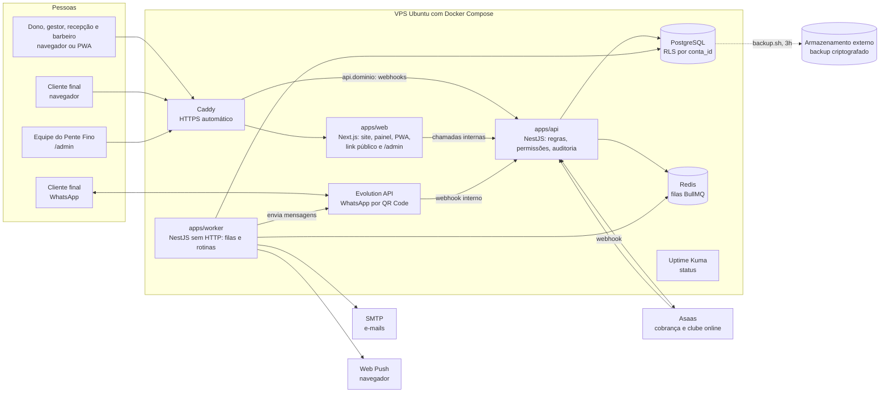

# Arquitetura

Como o Pente Fino é montado, do navegador ao banco. Para o detalhe de cada parte: rotas em
[gerado/api.md](gerado/api.md), telas em [gerado/telas.md](gerado/telas.md), tabelas em
[gerado/modelo-de-dados.md](gerado/modelo-de-dados.md). Operação do servidor em
[producao.md](producao.md).

## Visão de cima

## As partes do monorepo

| Parte | O que é | Detalhes |
| --- | --- | --- |
| `apps/web` | Next.js (App Router) + Tailwind, PWA | Site de vendas (`app/(site)`), painel logado (`app/(app)`), link público de agendamento (`/b/<slug>`), site da barbearia (`/s/<slug>` e domínio próprio, resolvido em `proxy.ts`), gestão do horário pelo cliente (`/horario`) e administração (`/admin`). Fala com a API por dentro (`API_URL`). Telas do painel em `componentes/telas`. |
| `apps/api` | NestJS | Um módulo por domínio em `apps/api/src/<módulo>`. Guardas globais: limite de requisições, autenticação (JWT), papel, assinatura e plano. Toda consulta de negócio passa por `BancoService.daConta()` → `naConta()`. Swagger em `/docs`. |
| `apps/worker` | NestJS sem HTTP | Processa as filas do Redis (BullMQ) e as rotinas agendadas. Um processador por assunto (abaixo). |
| `packages/db` | Prisma + PostgreSQL | `schema.prisma`, migrações SQL (com RLS, gatilhos e funções `SECURITY DEFINER` da plataforma), seed de demonstração e a lógica que roda direto no banco (bot, lembretes, avaliação, push, plataforma). |
| `packages/shared` | TypeScript puro | Esquemas zod (entrada da API e formulários), tipos de resposta e **todas as regras de cálculo**, com teste unitário. Usado pela API, pelo worker e pelo front. Consumido pela versão compilada (`dist`). |
| `packages/ui` | Componentes React | Botão, campo, diálogo, marcador, abas, tabela editável etc. Tokens de cor em `apps/web/src/app/globals.css`. |
| `packages/whatsapp` | Provedor de WhatsApp | Interface `ProvedorWhatsApp` com a Evolution API (produção) e um provedor falso (testes); leitura dos webhooks (`lerWebhookEvolution`). |
| `apps/video` | Remotion | Vídeos da marca (fora do produto). |
| `infra/` | Docker Compose, Caddy, scripts | Instalação, deploy, backup, restauração, vigia e diagnóstico. |

## Caminho de uma requisição

1. O navegador chama o Next (`seupentefino.com.br`). Telas do painel são montadas no navegador e
   buscam os dados pela rota `/api/*` do próprio Next, que repassa à API com o token da sessão.
2. A API valida a entrada com o esquema zod do `packages/shared`, confere papel, plano e
   assinatura (guardas) e abre uma transação com `naConta(contaId)`, que define
   `app.conta_id` na sessão do PostgreSQL. As políticas RLS filtram cada tabela por esse valor;
   o usuário do banco da aplicação não é superusuário e não ignora o RLS.
3. O que não precisa acontecer no clique (mensagem, e-mail, push, lembrete) vai para uma fila e o
   worker processa.

## Filas e rotinas (worker)

| Fila | Processador | O que faz |
| --- | --- | --- |
| `whatsapp-entrada` | `whatsapp.processor.ts` | Cada mensagem recebida, em ordem (uma por vez): o motor do bot responde, agenda e muda o estado da conversa. Também lembretes, pesquisa, oferta da lista de espera e avisos com atraso. |
| `whatsapp-rotinas` | `whatsapp.processor.ts` | Rotinas que passam por todas as contas (automações, avisos da equipe, cobrança manual). |
| `whatsapp-saida` | `whatsapp.processor.ts` | Envio pela Evolution API, com intervalo mínimo por número; segura automático de madrugada (22h às 7h). |
| `notificacoes` | `notificacoes.processor.ts` | Push no celular de quem ligou (Web Push, chaves VAPID). |
| `push-equipe` | `notificacoes.processor.ts` | Push da administração (chat do suporte). |
| `emails` | `emails.processor.ts` | E-mails transacionais (convite, senha, resumo do dia, cobrança). |
| `eventos` | `eventos.processor.ts` | Eventos de domínio publicados pela API. |
| `alertas-equipe` | `alertas.processor.ts` | Alertas da administração (contas paradas, etapas do funil). |
| `limpeza` | `limpeza.processor.ts` | Limpeza de dados vencidos (LGPD) e despesas fixas do mês. |

| Rotina agendada | Quando (São Paulo) |
| --- | --- |
| Alertas da administração | todo hora, aos 5 minutos |
| Limpeza de dados vencidos | 3h30 (depois do backup das 3h) |
| Despesas fixas e salários do mês | 6h |
| Avisos da assinatura (fim do teste, vencimento, cobrança) | 9h |
| Automações do bot (retorno, aniversário, aviso do clube) | 10h |
| Central de avisos (comandas pendentes, cliente esperando) | a cada 15 minutos |
| Backup (`infra/backup.sh`, cron do usuário `deploy`) | 3h |
| Vigia do servidor (`infra/vigia.sh`) | a cada 5 minutos |

## Integrações

| Integração | Uso | Onde |
| --- | --- | --- |
| Evolution API (WhatsApp não oficial, QR Code) | Bot, lembretes e avisos; um número por unidade | `packages/whatsapp`, `packages/db/src/bot.ts`, worker |
| Asaas | Assinatura do sistema, subconta da barbearia e clube online com split, nota fiscal | `apps/api/src/cobranca`, `apps/api/src/clube` |
| SMTP | E-mails | worker `emails` |
| Web Push (VAPID) | Notificação no celular | worker `notificacoes`, `apps/web/public/sw.js` |
| Google (Tag Manager, Ads, Search Console, IndexNow) | Site de vendas e páginas das barbearias | `apps/web`, `scripts/indexnow.mjs` |

## Segurança, em uma linha cada

- Isolamento por conta no banco (RLS); a administração usa outro usuário de banco e funções
  `SECURITY DEFINER` só com o necessário.
- Senhas com hash; segundo fator na administração; passkeys no painel.
- Webhooks conferem segredo (Asaas: `asaas-access-token`; WhatsApp: assinatura por instância e
  rota fechada para fora no Caddy); recusas vão para a Saúde do sistema.
- Segredos guardados pela administração cifrados (`packages/db/src/cifra.ts`, AES-256-GCM).
- Política de conteúdo (CSP) e cabeçalhos de segurança no Next (`next.config.ts`).
- Auditoria imutável das alterações sensíveis (`auditoria`, `auditoria_plataforma`).

## Produção

Uma VPS com Docker Compose: `caddy`, `postgres`, `redis`, `evolution`, `migracoes` (roda e sai),
`api`, `worker`, `web` e `status` (Uptime Kuma). Domínios: o principal e `www`/`app` (site e
painel), `api.` (webhooks), `wa.` (painel da Evolution, com senha) e `status.`. Cada merge na
`main` gera as imagens e o job "Implantar na VPS" roda `infra/implantar.sh`. Detalhes em
[producao.md](producao.md) e [restaurar.md](restaurar.md).
