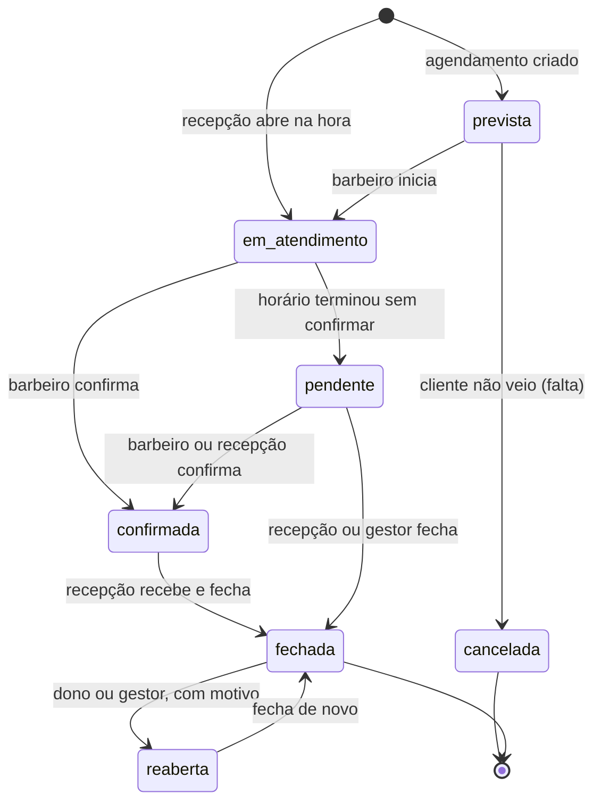

# Fluxos principais

O caminho de cada pessoa até o resultado. Quase todo fluxo termina numa **comanda fechada**, que
alimenta caixa, comissão e indicadores ([regras-de-negocio.md](regras-de-negocio.md)).

## Estados da comanda

## Conta nova e configuração guiada

1. A pessoa se cadastra no site (`/cadastro`), escolhe o plano e começa o teste de 14 dias, sem
   cartão. A origem do cadastro (campanha, indicação) fica gravada.
2. A **configuração guiada** (`/configuracao-inicial`) pede: dados da barbearia, unidade e horário
   de funcionamento, serviços com preço (com catálogo pronto) e barbeiros.
3. O cartão "Primeiros passos" no Início marca sozinho o que já foi feito: convidar a equipe,
   conectar o WhatsApp, primeiro agendamento, primeira comanda fechada, meta do mês.
4. A assinatura do sistema é cobrada pelo Asaas (Configurações → Assinatura); a conta parada fica
   só para consulta, sem perder dados.

## Dia da recepção

1. Abre a Agenda do dia; cada horário já tem a comanda prevista.
2. Cliente sem horário: abre a comanda na hora ou faz um encaixe.
3. Cliente não veio: marca falta; a comanda é cancelada (e pode avisar o cliente pelo WhatsApp).
4. Pode receber sinal (adiantado) com o caixa do dia aberto.
5. Barbeiro confirmou: a comanda aparece pronta para receber. Recebe (várias formas) e fecha.
6. Comanda sem confirmação vira pendente e entra na central de avisos.
7. No fim do dia, confere o caixa do sistema com o físico e fecha o dia.

## Dia do barbeiro (PWA)

1. Abre "Hoje": próximos clientes, meta do mês e comissão do dia.
2. Começa o atendimento; lança extras e produtos; troca o serviço se o cliente mudou.
3. Confirma ao terminar. A comissão atualiza quando a recepção fecha.
4. Vê desempenho, comissões (previsto, a receber, pago) e os próprios preços no Perfil. Sem
   internet, os lançamentos ficam guardados e saem quando a conexão volta.

## Rotina do dono

1. Início: o dia (o que entrou, agenda, o que precisa de ação) e o resumo do mês contra o mesmo
   período do mês anterior.
2. Resultados do mês: visão geral, barbeiros, serviços e produtos, canais, agenda e avaliações;
   baixa PDF ou planilha.
3. Financeiro: resultado contábil, despesas, comissões a pagar e o arquivo do contador.
4. Ajusta preços com vigência, metas e regras de agendamento.

## Cliente agenda sozinho

- **Pelo link** (`/b/<slug>`): escolhe serviço, barbeiro e horário livre; o horário entra na agenda
  com a comanda prevista. Recebe o link `/horario?t=...` para ver, remarcar ou cancelar dentro do
  prazo da unidade. Pode entrar na lista de espera do dia.
- **Pelo WhatsApp** (bot sem IA):
  1. Manda qualquer mensagem; recebe as boas-vindas e o menu numerado.
  2. Agendar: escolhe serviços (pode somar), profissional, dia e horário livre; ou manda uma
     frase ("quero cortar amanhã às 15h") e o bot entende por regras.
  3. Confirma: o agendamento e a comanda prevista nascem na hora.
  4. Lembretes (24 h e 2 h antes, ajustáveis; nunca de madrugada) com confirmar, remarcar e
     cancelar.
  5. Palavra-chave em qualquer ponto ("preço", "endereço") leva à resposta pronta; ATENDENTE passa
     para a equipe (bot pausado; MENU volta enquanto ninguém assumiu).
  6. Depois do atendimento, a pesquisa de 1 a 5; nota baixa avisa dono e gestor.
- **Pelo site da barbearia** (`/s/<slug>` ou domínio próprio): página montada em blocos pela
  barbearia, com os botões levando ao link de agendamento ou ao WhatsApp.

## Conversas com a equipe

O cliente pede atendente (ou a trava contra loop dispara) → a conversa entra em "Aguardando
atendente · bot pausado" em Conversas → alguém assume ou responde ("Em atendimento humano") →
"Devolver ao bot". Responder pelo celular da barbearia também pausa o bot. Cada mudança fica no
histórico do estado, com horário, origem e quem fez.

## Clube

1. O dono cria planos (assinatura, combo, convênio) por unidade.
2. A adesão é feita no balcão (baixa manual, com QR Pix da barbearia) ou pelo link do clube
   online (Asaas com split: o dinheiro vai direto para a subconta da barbearia).
3. Na comanda do assinante, o que o plano cobre entra com valor zero e conta no uso do ciclo.
4. A mensalidade entra no faturamento no dia em que é paga.

## Lista de espera

Horário que vaga (cancelamento ou remarcação) é oferecido pelo bot a quem pediu aquele dia, em
ordem; o primeiro que responder leva, e os outros recebem "já foi preenchido".

## Administração da plataforma (`/admin`)

Equipe do Pente Fino (papéis admin, vendedor e suporte): contas e funil, vendas manuais, cobrança
e notas fiscais, chat com clientes e visitantes, saúde do sistema (filas, WhatsApp, backup,
webhooks recusados), configurações (preços, textos, teste grátis) e acesso de suporte quando a
barbearia libera.
