<!-- Gerado por scripts/docs/gerar-docs.mjs (pnpm docs:gerar). Não edite à mão: mude o código e gere de novo. -->

# Modelo de dados

66 entidades e 29 enums em `packages/db/prisma/schema.prisma`. Toda tabela de negócio tem `conta_id` com RLS (`app.conta_id`); dinheiro em centavos (inteiro); datas em UTC. Nomes em camelCase são os do Prisma; a coluna no banco é o `@map` (snake_case).

## Entidades

| Entidade (Prisma) | Tabela | Campos | Isolada por conta | Para que serve |
| --- | --- | --- | --- | --- |
| [Conta](#conta) | `conta` | 34 | não | Raiz do isolamento multiempresa. O RLS compara o próprio id com app.conta_id. |
| [Unidade](#unidade) | `unidade` | 29 | sim |  |
| [CalendarioUnidade](#calendariounidade) | `calendario_unidade` | 8 | sim | Exceções ao expediente padrão (feriado, folga, dia extra). Base da projeção. |
| [Usuario](#usuario) | `usuario` | 11 | sim | E-mail único no sistema todo: o login acha a conta pelo e-mail. |
| [PapelUsuario](#papelusuario) | `papel_usuario` | 7 | sim | Unidade vazia = o papel vale em todas as unidades da conta. |
| [TokenAcesso](#tokenacesso) | `token_acesso` | 12 | sim | Tokens opacos de uso único: renovação de sessão, redefinição de senha e convite. Só o hash SHA-256 fica no banco. A API acha o token pelo hash antes de saber a conta, por isso a migração "autenticacao" libera a leitura pelo hash da sessão. |
| [Passkey](#passkey) | `passkey` | 13 | sim | Passkey do usuário (entrar com a digital ou o rosto do celular, pedido do dono em 15/11). Só a chave pública fica aqui; o segredo nunca sai do aparelho. |
| [Profissional](#profissional) | `profissional` | 11 | sim | Barbeiro é cadastro, não coluna: um usuário pode atender em mais de uma unidade. |
| [HorarioProfissional](#horarioprofissional) | `horario_profissional` | 8 | sim | Expediente semanal. Minutos desde a meia-noite, no fuso da unidade. |
| [BloqueioAgenda](#bloqueioagenda) | `bloqueio_agenda` | 8 | sim | Almoço, folga, compromisso: tira o horário da agenda. |
| [RegraComissao](#regracomissao) | `regra_comissao` | 9 | sim | Percentual (pontos-base) ou valor fixo, nunca os dois. Vale a partir de vigencia_inicio. |
| [Servico](#servico) | `servico` | 15 | sim | Peso: principal 1, extra 0, combo = soma dos inclusos. Define "atendimentos". |
| [PrecoProfissional](#precoprofissional) | `preco_profissional` | 8 | sim | Uma linha por mudança de preço. O preço vigente é a maior vigência até a data. Preço próprio do barbeiro para um serviço (o barbeiro muda no perfil dele). Vale quando marcam com ele e na comanda dele; valor nulo a partir de uma data = volta para o preço da unidade. |
| [PrecoServico](#precoservico) | `preco_servico` | 8 | sim |  |
| [Produto](#produto) | `produto` | 11 | sim |  |
| [Cliente](#cliente) | `cliente` | 16 | sim | Telefone em dígitos com DDI (5511999998888); único por conta quando informado. |
| [NotaCliente](#notacliente) | `nota_cliente` | 8 | sim |  |
| [Agendamento](#agendamento) | `agendamento` | 17 | sim | Cria a comanda prevista. Dois agendamentos ativos do mesmo profissional não se sobrepõem (restrição de exclusão na migração "restricoes"). |
| [Comanda](#comanda) | `comanda` | 20 | sim | Só comanda fechada entra em faturamento, comissão e indicadores. |
| [ItemComanda](#itemcomanda) | `item_comanda` | 21 | sim | Grava preço, custo, peso e comissão do momento: mudanças futuras não reescrevem o passado. |
| [Pagamento](#pagamento) | `pagamento` | 10 | sim |  |
| [CaixaDia](#caixadia) | `caixa_dia` | 14 | sim |  |
| [CategoriaDespesa](#categoriadespesa) | `categoria_despesa` | 7 | sim | Investimento, retirada do dono e cartão/resgates ficam fora do % operacional. |
| [Despesa](#despesa) | `despesa` | 15 | sim | Unidade vazia = despesa da conta (rateio fica para os relatórios). |
| [PagamentoComissao](#pagamentocomissao) | `pagamento_comissao` | 10 | sim |  |
| [Meta](#meta) | `meta` | 9 | sim | O valor atual é calculado, não guardado. |
| [Auditoria](#auditoria) | `auditoria` | 10 | sim | Imutável: um gatilho recusa UPDATE e DELETE (migração "restricoes"). |
| [BotConexao](#botconexao) | `bot_conexao` | 10 | sim | Um número por unidade. "instancia" é o nome da instância na Evolution API. |
| [BotSessao](#botsessao) | `bot_sessao` | 10 | sim | Onde cada número está no menu do bot. Sem resposta por 30 minutos, recomeça. |
| [BotSessaoEvento](#botsessaoevento) | `bot_sessao_evento` | 9 | sim | Histórico do estado da conversa (testes de 19/11/2026): gravado pelo gatilho bot_sessao_estado a cada mudança entre bot, aguardando e atendimento, com a origem (app.origem_conversa). |
| [Mensagem](#mensagem) | `mensagem` | 15 | sim | Mensagens do WhatsApp, recebidas e enviadas. Histórico no perfil do cliente. |
| [BotMenu](#botmenu) | `bot_menu` | 9 | sim | Versões do menu do bot (sem IA). Uma em rascunho e uma publicada por conta; as publicadas antes ficam arquivadas para "voltar à versão anterior". O menu é um documento (MenuBot de @pente-fino/shared), validado antes de publicar. |
| [ModeloMensagem](#modelomensagem) | `modelo_mensagem` | 8 | sim | Texto com variáveis entre chaves: {cliente}, {data}, {hora}, {profissional}, {unidade}. Unidade vazia = modelo padrão da conta. |
| [Avaliacao](#avaliacao) | `avaliacao` | 21 | sim | Pesquisa depois do atendimento: uma por comanda, notas de 1 a 5 e comentário. |
| [FaturaAssinatura](#faturaassinatura) | `fatura_assinatura` | 19 | sim | Faturas da assinatura do Pente Fino pela barbearia. A conta só lê; quem grava é o sistema (cobrança automática ou a administração). |
| [NotaFiscalMensalidade](#notafiscalmensalidade) | `nota_fiscal_mensalidade` | 13 | sim | Nota fiscal (NFS-e) de uma mensalidade do Pente Fino, emitida pelo Asaas e acompanhada pelo webhook (admin R2). Liga com a fatura pelo pagamento do Asaas (fatura_assinatura.id_externo). |
| [AssistenteEquipe](#assistenteequipe) | `assistente_equipe` | 12 | sim | Assistente da equipe no WhatsApp (Etapa 11): o profissional confirma o próprio número mandando um código para o WhatsApp da unidade e recebe avisos da agenda dele. |
| [LinkHorario](#linkhorario) | `link_horario` | 5 | sim | Link para o cliente ver, remarcar ou cancelar o próprio horário sem login (/horario?t=token). Guarda só o SHA-256 do token; um link novo substitui o anterior. |
| [TokenAgendamento](#tokenagendamento) | `token_agendamento` | 8 | sim | Link do site mandado pelo bot (/agendar?u=slug&c=token): nome e telefone já preenchidos, sem dado pessoal na URL. Curto, de uso único e com validade; guarda só o hash. |
| [InscricaoPush](#inscricaopush) | `inscricao_push` | 8 | sim | Aparelho que ligou as notificações no Perfil (push do PWA). Some quando o navegador avisa que a inscrição acabou (404/410) ou a pessoa desliga. |
| [ItemClube](#itemclube) | `item_clube` | 11 | sim | Plano do clube numa unidade: assinatura (mensal), combo ou convênio. O valor é por ciclo. |
| [ItemClubeServico](#itemclubeservico) | `item_clube_servico` | 6 | sim | Serviço incluso no plano: quantas vezes por ciclo e, se o dono quiser, a comissão fixa dele. |
| [AdesaoClube](#adesaoclube) | `adesao_clube` | 13 | sim | Cliente no plano: o ciclo vai do vencimento anterior (um mês antes) até o vencimento. |
| [PagamentoClube](#pagamentoclube) | `pagamento_clube` | 15 | sim | Mensalidade do clube recebida no balcão (Pix da barbearia, dinheiro ou cartão) ou online. É receita do clube, separada da receita de serviço: entra no faturamento do mês no dia do pagamento (repasse ?? valor), numa linha própria, mas não nas comandas nem no desempenho por barbeiro. |
| [RecebimentoOnline](#recebimentoonline) | `recebimento_online` | 10 | sim | Conta da barbearia para receber online (subconta do Asaas): o split manda a mensalidade direto para a carteira dela. A chave de API da subconta fica cifrada (PLATAFORMA_CHAVE). |
| [AssinaturaClubeOnline](#assinaturaclubeonline) | `assinatura_clube_online` | 12 | sim | Assinatura do clube feita pelo link (cobrança recorrente no Asaas com split). A adesão nasce no primeiro pagamento e renova a cada mensalidade paga. |
| [ListaEspera](#listaespera) | `lista_espera` | 16 | sim | Lista de espera: o cliente quer um horário no dia, numa faixa, com um profissional (ou qualquer um). Quando vaga um horário que cabe, o bot oferece na ordem de chegada. |
| [BloqueioRecorrente](#bloqueiorecorrente) | `bloqueio_recorrente` | 10 | sim | Bloqueio que repete toda semana (almoço de toda terça), de uma data até outra (ou sem fim). |
| [Aviso](#aviso) | `aviso` | 11 | sim | Central de avisos (Etapa 15): o que cada pessoa precisa resolver, com histórico. Também vira notificação no celular para quem ligou o push. `chave` evita repetir o mesmo aviso. |
| [FunilEtapaConta](#funiletapaconta) | `funil_etapa_conta` | 4 | sim | Quem opera o Pente Fino. Nunca reaproveita o login de uma barbearia. Admin F1d: em que etapa do funil cada conta está, desde quando, e se já recebeu o e-mail de ajuda desta etapa. Só a administração (e a rotina dela no worker) lê e grava. |
| [ConversaSuporte](#conversasuporte) | `conversa_suporte` | 15 | não | Admin F6: conversa do chat do site com a equipe do Pente Fino. O visitante lê e escreve com o token que recebeu (só o hash fica aqui). Tabela só da administração. |
| [MensagemSuporte](#mensagemsuporte) | `mensagem_suporte` | 6 | não |  |
| [InscricaoPushPlataforma](#inscricaopushplataforma) | `inscricao_push_plataforma` | 7 | não | Admin F6: aparelhos da equipe da plataforma que recebem push (conversa e mensagem nova do chat). |
| [AlertaEquipeEnviado](#alertaequipeenviado) | `alerta_equipe_enviado` | 3 | não | Admin F3: alertas da equipe que já saíram. O mesmo tipo + chave nunca sai duas vezes. |
| [UsuarioPlataforma](#usuarioplataforma) | `usuario_plataforma` | 14 | não |  |
| [SessaoPlataforma](#sessaoplataforma) | `sessao_plataforma` | 8 | não | Sessão curta de quem administra: só o hash do token; IP e navegador registrados. |
| [NotaInternaConta](#notainternaconta) | `nota_interna_conta` | 5 | não | Notas internas da equipe da plataforma sobre uma conta (admin U3): combinados, contexto da venda, o que o dono pediu. A barbearia nunca vê. Fora do RLS das barbearias (como a auditoria). |
| [AuditoriaPlataforma](#auditoriaplataforma) | `auditoria_plataforma` | 9 | não | Toda ação de admin e vendedor: quem, quando, em que conta, antes e depois. Imutável. |
| [ConfiguracaoPlataforma](#configuracaoplataforma) | `configuracao_plataforma` | 4 | não | Configurações do sistema, editadas na administração (chave → valor JSON validado em packages/shared/src/configuracao-sistema.ts). Fora das contas: a aplicação só lê o que a função configuracao_do_sistema() libera (nunca segredos). |
| [ExecucaoLimpeza](#execucaolimpeza) | `execucao_limpeza` | 7 | não | Execuções da rotina diária de limpeza (Etapa 15.4): quanto saiu de cada tipo. Fora do RLS das barbearias (não pertence a uma conta); o worker grava e a administração lê. |
| [FotoSite](#fotosite) | `foto_site` | 7 | sim | Foto do site da barbearia (seção 7, lote 7c). O arquivo fica no disco do servidor (FOTOS_DIR/<id>-640.webp e -1600.webp, já sem os dados da câmera); aqui, de quem é e o tamanho. |
| [EnderecoAntigo](#enderecoantigo) | `endereco_antigo` | 6 | sim | Endereço que a unidade deixou de usar (lote 7d): o link de agendamento (/b/<slug>) ou o site (/s/<slug>). Quem chega pelo antigo é levado ao atual; nada impresso ou divulgado quebra. |
| [EventoVisitaSite](#eventovisitasite) | `evento_visita_site` | 8 | não | O que o visitante faz na página de vendas (pedido do dono em 13/11): um evento anônimo por entrada, marca de rolagem ou clique. Sem dado pessoal; tabela só da administração. |
| [DepoimentoSite](#depoimentosite) | `depoimento_site` | 11 | não | Depoimentos da página de vendas (pedido do dono em 14/11). Tabela só da administração. |
| [Indicador](#indicador) | `indicador` | 11 | sim | Indique e ganhe (pedido do dono em 14/11): quem indica, cliente ou não. Tabela só da administração; o painel do indicador abre pelo link secreto (só o hash fica aqui). |
| [ComissaoIndicacao](#comissaoindicacao) | `comissao_indicacao` | 11 | sim | Uma comissão por fatura paga da indicada (o gatilho da migração "indique_e_ganhe" cria). |

## Relações

```mermaid
erDiagram
  Conta ||--o{ Unidade : "conta"
  Conta ||--o{ CalendarioUnidade : "conta"
  Unidade ||--o{ CalendarioUnidade : "unidade"
  Conta ||--o{ Usuario : "conta"
  Conta ||--o{ PapelUsuario : "conta"
  Usuario ||--o{ PapelUsuario : "usuario"
  Unidade |o--o{ PapelUsuario : "unidade"
  Conta ||--o{ TokenAcesso : "conta"
  Usuario ||--o{ TokenAcesso : "usuario"
  Conta ||--o{ Passkey : "conta"
  Usuario ||--o{ Passkey : "usuario"
  Conta ||--o{ Profissional : "conta"
  Usuario ||--o{ Profissional : "usuario"
  Unidade ||--o{ Profissional : "unidade"
  Conta ||--o{ HorarioProfissional : "conta"
  Profissional ||--o{ HorarioProfissional : "profissional"
  Conta ||--o{ BloqueioAgenda : "conta"
  Profissional ||--o{ BloqueioAgenda : "profissional"
  Conta ||--o{ RegraComissao : "conta"
  Profissional ||--o{ RegraComissao : "profissional"
  Conta ||--o{ Servico : "conta"
  Conta ||--o{ PrecoProfissional : "conta"
  Profissional ||--o{ PrecoProfissional : "profissional"
  Servico ||--o{ PrecoProfissional : "servico"
  Conta ||--o{ PrecoServico : "conta"
  Servico ||--o{ PrecoServico : "servico"
  Unidade ||--o{ PrecoServico : "unidade"
  Conta ||--o{ Produto : "conta"
  Conta ||--o{ Cliente : "conta"
  Unidade |o--o{ Cliente : "unidadeOrigem"
  Conta ||--o{ NotaCliente : "conta"
  Cliente ||--o{ NotaCliente : "cliente"
  Profissional |o--o{ NotaCliente : "profissional"
  Usuario |o--o{ NotaCliente : "autor"
  Conta ||--o{ Agendamento : "conta"
  Unidade ||--o{ Agendamento : "unidade"
  Profissional ||--o{ Agendamento : "profissional"
  Cliente |o--o{ Agendamento : "cliente"
  Usuario |o--o{ Agendamento : "criadoPor"
  Conta ||--o{ Comanda : "conta"
  Unidade ||--o{ Comanda : "unidade"
  Cliente |o--o{ Comanda : "cliente"
  Profissional ||--o{ Comanda : "profissional"
  Agendamento |o--o{ Comanda : "agendamento"
  Usuario |o--o{ Comanda : "fechadaPor"
  Usuario |o--o{ Comanda : "confirmadaPor"
  Conta ||--o{ ItemComanda : "conta"
  Comanda ||--o{ ItemComanda : "comanda"
  Servico |o--o{ ItemComanda : "servico"
  Produto |o--o{ ItemComanda : "produto"
  Profissional |o--o{ ItemComanda : "profissional"
  AdesaoClube |o--o{ ItemComanda : "adesao"
  Conta ||--o{ Pagamento : "conta"
  Comanda ||--o{ Pagamento : "comanda"
  Usuario |o--o{ Pagamento : "recebidoPor"
  Conta ||--o{ CaixaDia : "conta"
  Unidade ||--o{ CaixaDia : "unidade"
  Usuario |o--o{ CaixaDia : "abertoPor"
  Usuario |o--o{ CaixaDia : "fechadoPor"
  Conta ||--o{ CategoriaDespesa : "conta"
  Conta ||--o{ Despesa : "conta"
  Unidade |o--o{ Despesa : "unidade"
  CategoriaDespesa ||--o{ Despesa : "categoria"
  Despesa |o--o{ Despesa : "origem"
  Profissional |o--o{ Despesa : "profissional"
  Conta ||--o{ PagamentoComissao : "conta"
  Profissional ||--o{ PagamentoComissao : "profissional"
  Usuario |o--o{ PagamentoComissao : "pagoPor"
  Conta ||--o{ Meta : "conta"
  Unidade ||--o{ Meta : "unidade"
  Servico |o--o{ Meta : "servico"
  Conta ||--o{ Auditoria : "conta"
  Usuario |o--o{ Auditoria : "usuario"
  Conta ||--o{ BotConexao : "conta"
  Unidade ||--o{ BotConexao : "unidade"
  Conta ||--o{ BotSessao : "conta"
  Unidade ||--o{ BotSessao : "unidade"
  Cliente |o--o{ BotSessao : "cliente"
  Conta ||--o{ BotSessaoEvento : "conta"
  Unidade ||--o{ BotSessaoEvento : "unidade"
  BotSessao ||--o{ BotSessaoEvento : "sessao"
  Usuario |o--o{ BotSessaoEvento : "autor"
  Conta ||--o{ Mensagem : "conta"
  Unidade ||--o{ Mensagem : "unidade"
  Cliente |o--o{ Mensagem : "cliente"
  Usuario |o--o{ Mensagem : "autor"
  Conta ||--o{ BotMenu : "conta"
  Usuario |o--o{ BotMenu : "publicadoPor"
  Unidade |o--o{ BotMenu : "unidade"
  Conta ||--o{ ModeloMensagem : "conta"
  Unidade |o--o{ ModeloMensagem : "unidade"
  Conta ||--o{ Avaliacao : "conta"
  Unidade ||--o{ Avaliacao : "unidade"
  Comanda ||--o{ Avaliacao : "comanda"
  Profissional ||--o{ Avaliacao : "profissional"
  Cliente ||--o{ Avaliacao : "cliente"
  Usuario |o--o{ Avaliacao : "tratadaPor"
  Conta ||--o{ FaturaAssinatura : "conta"
  Conta ||--o{ NotaFiscalMensalidade : "conta"
  Conta ||--o{ AssistenteEquipe : "conta"
  Usuario ||--o{ AssistenteEquipe : "usuario"
  Unidade ||--o{ AssistenteEquipe : "unidade"
  Conta ||--o{ LinkHorario : "conta"
  Agendamento ||--o{ LinkHorario : "agendamento"
  Conta ||--o{ TokenAgendamento : "conta"
  Unidade ||--o{ TokenAgendamento : "unidade"
  Cliente ||--o{ TokenAgendamento : "cliente"
  Conta ||--o{ InscricaoPush : "conta"
  Usuario ||--o{ InscricaoPush : "usuario"
  Conta ||--o{ ItemClube : "conta"
  Unidade ||--o{ ItemClube : "unidade"
  Conta ||--o{ ItemClubeServico : "conta"
  ItemClube ||--o{ ItemClubeServico : "itemClube"
  Servico ||--o{ ItemClubeServico : "servico"
  Conta ||--o{ AdesaoClube : "conta"
  Cliente ||--o{ AdesaoClube : "cliente"
  ItemClube ||--o{ AdesaoClube : "itemClube"
  Usuario |o--o{ AdesaoClube : "criadoPor"
  Conta ||--o{ PagamentoClube : "conta"
  AdesaoClube ||--o{ PagamentoClube : "adesao"
  Usuario |o--o{ PagamentoClube : "recebidoPor"
  Conta ||--o{ RecebimentoOnline : "conta"
  Conta ||--o{ AssinaturaClubeOnline : "conta"
  ItemClube ||--o{ AssinaturaClubeOnline : "itemClube"
  Cliente ||--o{ AssinaturaClubeOnline : "cliente"
  AdesaoClube |o--o{ AssinaturaClubeOnline : "adesao"
  Conta ||--o{ ListaEspera : "conta"
  Unidade ||--o{ ListaEspera : "unidade"
  Cliente ||--o{ ListaEspera : "cliente"
  Profissional |o--o{ ListaEspera : "profissional"
  Agendamento |o--o{ ListaEspera : "agendamento"
  Conta ||--o{ BloqueioRecorrente : "conta"
  Profissional ||--o{ BloqueioRecorrente : "profissional"
  Conta ||--o{ Aviso : "conta"
  Usuario ||--o{ Aviso : "usuario"
  Unidade |o--o{ Aviso : "unidade"
  Conta ||--o{ FunilEtapaConta : "conta"
  UsuarioPlataforma |o--o{ ConversaSuporte : "atendente"
  ConversaSuporte ||--o{ MensagemSuporte : "conversa"
  UsuarioPlataforma |o--o{ MensagemSuporte : "autor"
  UsuarioPlataforma ||--o{ InscricaoPushPlataforma : "usuario"
  UsuarioPlataforma ||--o{ SessaoPlataforma : "usuario"
  UsuarioPlataforma |o--o{ NotaInternaConta : "autor"
  UsuarioPlataforma |o--o{ AuditoriaPlataforma : "usuario"
  Conta ||--o{ FotoSite : "conta"
  Unidade ||--o{ FotoSite : "unidade"
  Conta ||--o{ EnderecoAntigo : "conta"
  Unidade ||--o{ EnderecoAntigo : "unidade"
  Indicador ||--o{ ComissaoIndicacao : "indicador"
```

## Campos por entidade

### Conta

Tabela `conta`. Raiz do isolamento multiempresa. O RLS compara o próprio id com app.conta_id.

| Campo | Tipo | Obrigatório | Observação |
| --- | --- | --- | --- |
| id | String | sim | chave; padrão dbgenerated("uuidv7( |
| nome | String | sim |  |
| logoUrl | String | não | coluna `logo_url` |
| plano | Plano | sim | enum Plano; padrão basico |
| automacoesContratadas | Boolean | sim | Automações contratadas à parte (Agenda e Básico): bot, lista de espera, pesquisa, retorno e aniversário. Do Pro em diante já vêm no plano.; padrão false; coluna `automacoes_contratadas` |
| experimentaBasicoAte | DateTime | não | "Experimentar 7 dias" no Agenda: os recursos do Básico até esta data (uma vez por conta).; coluna `experimenta_basico_ate` |
| indicadoPor | String | não | Indique e ganhe: o código de quem indicou (link /cadastro?indicacao=).; coluna `indicado_por` |
| status | StatusConta | sim | enum StatusConta; padrão teste |
| ocultarTelefoneBarbeiro | Boolean | sim | Esconde o telefone do cliente na tela do barbeiro (docs: matriz de permissões).; padrão true; coluna `ocultar_telefone_barbeiro` |
| precoLivreBarbeiro | Boolean | sim | O barbeiro também digita o valor de serviço com preço livre (padrão: só o balcão).; padrão false; coluna `preco_livre_barbeiro` |
| configuradaEm | DateTime | não | Quando o dono terminou a configuração guiada (null = ainda não terminou).; coluna `configurada_em` |
| ciclo | CicloCobranca | sim | enum CicloCobranca; padrão mensal |
| testeAte | DateTime | não | Fim do teste grátis (null = não está em teste).; coluna `teste_ate` |
| pesquisaPosAtendimento | Boolean | sim | Pesquisa de 1 a 5 pelo WhatsApp depois do atendimento (o dono pode desligar).; padrão true; coluna `pesquisa_pos_atendimento` |
| automacoes | Json | sim | Automações do pós-atendimento (retorno, aniversário); JSON validado em packages/shared/src/automacoes.ts.; padrão "{}" |
| pix | Json | não | Pix da barbearia para a mensalidade do clube (chave, nome e cidade de quem recebe). |
| documento | String | não | CPF ou CNPJ de quem paga a assinatura (só dígitos); o Asaas exige. |
| asaasClienteId | String | não | Cliente e assinatura no Asaas (cobrança automática, Etapa 10.1 em teste e 23).; único; coluna `asaas_cliente_id` |
| asaasAssinaturaId | String | não | único; coluna `asaas_assinatura_id` |
| vendedorId | String | não | Cancelamento (pela administração ou pelo dono): quando e o motivo informado (cancelamentos do mês). Quem da plataforma vendeu (venda presencial); sem chave estrangeira: a tabela da plataforma fica fora do alcance da aplicação.; coluna `vendedor_id` |
| precosDesde | DateTime | não | Data da tabela de preços contratada (assinatura ou última troca de plano); null = a do lançamento.; coluna `precos_desde` |
| origem | Json | não | De onde veio o cadastro (gclid, gbraid, wbraid, utm_*, domínio de origem): site T2 e admin F2. Só parâmetros de campanha, nunca dado pessoal. |
| interna | Boolean | sim | Conta da própria equipe (testes, demonstração, implantação): fora do MRR, das métricas, do "Precisa de atenção" e da cobrança manual (admin R5).; padrão false |
| statusAnterior | StatusConta | não | O que a conta era antes de a administração bloquear (desbloquear volta exatamente a isso).; enum StatusConta; coluna `status_anterior` |
| cortesiaAte | DateTime | não | Cortesia: ativa sem cobrança até esta data (inclusive), com motivo na auditoria.; coluna `cortesia_ate` |
| cobrarAPartirDe | DateTime | não | Cobrança manual começa nesta data (reativação, fim da cortesia ou decisão da administração).; coluna `cobrar_a_partir_de` |
| suporteLiberadoAte | DateTime | não | Admin F5: o dono liberou o acesso de suporte (só leitura) até este momento.; coluna `suporte_liberado_ate` |
| cupom | String | não | Cupom usado ao contratar e o desconto dele (pontos-base), enquanto a assinatura existir. |
| descontoBp | Int | sim | padrão 0; coluna `desconto_bp` |
| canceladaEm | DateTime | não | coluna `cancelada_em` |
| motivoCancelamento | String | não | coluna `motivo_cancelamento` |
| fluxoAnuncio | Json | não | Mensagens automáticas de quem vem de anúncio (pedido do dono em 16/11/2026); nulo = desligado.; coluna `fluxo_anuncio` |
| criadoEm | DateTime | sim | padrão now(); coluna `criado_em` |
| atualizadoEm | DateTime | sim | coluna `atualizado_em` |
| unidades | Unidade[] | não | lista de Unidade |
| calendarios | CalendarioUnidade[] | não | lista de CalendarioUnidade |
| usuarios | Usuario[] | não | lista de Usuario |
| papeis | PapelUsuario[] | não | lista de PapelUsuario |
| profissionais | Profissional[] | não | lista de Profissional |
| horarios | HorarioProfissional[] | não | lista de HorarioProfissional |
| bloqueios | BloqueioAgenda[] | não | lista de BloqueioAgenda |
| regrasComissao | RegraComissao[] | não | lista de RegraComissao |
| precosProfissional | PrecoProfissional[] | não | lista de PrecoProfissional |
| servicos | Servico[] | não | lista de Servico |
| precosServico | PrecoServico[] | não | lista de PrecoServico |
| produtos | Produto[] | não | lista de Produto |
| clientes | Cliente[] | não | lista de Cliente |
| notasCliente | NotaCliente[] | não | lista de NotaCliente |
| agendamentos | Agendamento[] | não | lista de Agendamento |
| comandas | Comanda[] | não | lista de Comanda |
| itensComanda | ItemComanda[] | não | lista de ItemComanda |
| pagamentos | Pagamento[] | não | lista de Pagamento |
| caixas | CaixaDia[] | não | lista de CaixaDia |
| categoriasDespesa | CategoriaDespesa[] | não | lista de CategoriaDespesa |
| despesas | Despesa[] | não | lista de Despesa |
| pagamentosComissao | PagamentoComissao[] | não | lista de PagamentoComissao |
| metas | Meta[] | não | lista de Meta |
| auditorias | Auditoria[] | não | lista de Auditoria |
| botConexoes | BotConexao[] | não | lista de BotConexao |
| botMenus | BotMenu[] | não | lista de BotMenu |
| modelosMensagem | ModeloMensagem[] | não | lista de ModeloMensagem |
| botSessoes | BotSessao[] | não | lista de BotSessao |
| botSessaoEventos | BotSessaoEvento[] | não | lista de BotSessaoEvento |
| mensagens | Mensagem[] | não | lista de Mensagem |
| tokenAcessos | TokenAcesso[] | não | lista de TokenAcesso |
| avaliacoes | Avaliacao[] | não | lista de Avaliacao |
| faturas | FaturaAssinatura[] | não | lista de FaturaAssinatura |
| notasFiscais | NotaFiscalMensalidade[] | não | lista de NotaFiscalMensalidade |
| assistentes | AssistenteEquipe[] | não | lista de AssistenteEquipe |
| linksHorario | LinkHorario[] | não | lista de LinkHorario |
| tokensAgendamento | TokenAgendamento[] | não | lista de TokenAgendamento |
| inscricoesPush | InscricaoPush[] | não | lista de InscricaoPush |
| itensClube | ItemClube[] | não | lista de ItemClube |
| servicosClube | ItemClubeServico[] | não | lista de ItemClubeServico |
| adesoesClube | AdesaoClube[] | não | lista de AdesaoClube |
| pagamentosClube | PagamentoClube[] | não | lista de PagamentoClube |
| recebimentoOnline | RecebimentoOnline | não | relação com RecebimentoOnline |
| assinaturasClube | AssinaturaClubeOnline[] | não | lista de AssinaturaClubeOnline |
| listaEspera | ListaEspera[] | não | lista de ListaEspera |
| bloqueiosRecorrentes | BloqueioRecorrente[] | não | lista de BloqueioRecorrente |
| avisos | Aviso[] | não | lista de Aviso |
| funilEtapa | FunilEtapaConta | não | relação com FunilEtapaConta |
| fotosSite | FotoSite[] | não | lista de FotoSite |
| enderecosAntigos | EnderecoAntigo[] | não | lista de EnderecoAntigo |
| passkeys | Passkey[] | não | lista de Passkey |

### Unidade

Tabela `unidade`.

| Campo | Tipo | Obrigatório | Observação |
| --- | --- | --- | --- |
| id | String | sim | chave; padrão dbgenerated("uuidv7( |
| contaId | String | sim | padrão dbgenerated("conta_atual(; coluna `conta_id` |
| nome | String | sim |  |
| endereco | String | não |  |
| cidade | String | não | Cidade e UF (testes de 19/11/2026): o link do mapa leva o endereço completo. |
| uf | String | não |  |
| linkMapa | String | não | Link de localização escolhido pela barbearia (Google Maps); vale no lugar da busca.; coluna `link_mapa` |
| telefone | String | não |  |
| diasTrabalho | Int[] | não | Dias da semana com expediente: 0 = domingo … 6 = sábado.; padrão [1, 2, 3, 4, 5, 6]; coluna `dias_trabalho` |
| horarioFuncionamento | Json | sim | Horário de funcionamento (pedido do dono em 13/11): turnos por dia da semana (até dois, com almoço), em minutos. Vazio = sem limite além do expediente da equipe. Validado no shared.; padrão "[]"; coluna `horario_funcionamento` |
| capacidade | Int | sim | Cadeiras atendendo ao mesmo tempo; alimenta a ocupação.; padrão 1 |
| fuso | String | sim | padrão "America/Sao_Paulo" |
| ativa | Boolean | sim | padrão true |
| slug | String | não | Endereço do link público de agendamento (/agendar?u=slug). Único no sistema.; único |
| agendamentoPublico | Boolean | sim | Link público ligado: só então a página de agendamento responde.; padrão false; coluna `agendamento_publico` |
| aparecerNoGoogle | Boolean | sim | [DECISÃO DO DONO] A página da unidade (/b/slug) aparece no Google. Desligado (padrão), fica fora da busca (noindex) e do sitemap (painel P4).; padrão false; coluna `aparecer_no_google` |
| regrasAgendamento | Json | sim | Regras de agendamento (antecedência, janela, prazos, intervalo, lembretes). JSON validado em packages/shared (regras-agendamento.ts); vazio = padrão.; padrão "{}"; coluna `regras_agendamento` |
| linkAvaliacaoGoogle | String | não | Link para o cliente avaliar a unidade no Google (convite depois de nota 5).; coluna `link_avaliacao_google` |
| botHorario | Json | não | Horário do bot: lista de turnos (TurnoBot). Vazio = segue o expediente da equipe.; coluna `bot_horario` |
| siteRascunho | Json | não | Site da barbearia (seção 7): blocos, textos e tema que o dono edita (siteBarbeariaSchema).; coluna `site_rascunho` |
| sitePublicado | Json | não | Cópia do rascunho no último "Publicar". Nulo = sem site: /b/slug é a página de agendamento.; coluna `site_publicado` |
| sitePublicadoEm | DateTime | não | coluna `site_publicado_em` |
| siteSlug | String | não | Endereço do site (/s/<site_slug>), separado do link de agendamento (lote 7d). Único.; único; coluna `site_slug` |
| dominio | String | não | Domínio próprio do site (lote 7e), sem "www.". Único no sistema.; único |
| dominioVerificadoEm | DateTime | não | Quando o DNS do domínio foi conferido apontando para o Pente Fino; nulo = ainda não.; coluna `dominio_verificado_em` |
| agendamentoVisual | Json | não | Visual da página de agendamento (lote 7l): cor, logotipo, capa e boas-vindas. Nulo = o de sempre do Pente Fino. Separado do site; vale assim que o dono salva.; coluna `agendamento_visual` |
| fluxoAnuncio | Json | não | Mensagens de anúncio próprias da unidade (sugestão aprovada em 16/11/2026); nulo = as da conta.; coluna `fluxo_anuncio` |
| criadoEm | DateTime | sim | padrão now(); coluna `criado_em` |
| atualizadoEm | DateTime | sim | coluna `atualizado_em` |
| conta | Conta | sim | relação com Conta |
| calendario | CalendarioUnidade[] | não | lista de CalendarioUnidade |
| papeis | PapelUsuario[] | não | lista de PapelUsuario |
| profissionais | Profissional[] | não | lista de Profissional |
| precosServico | PrecoServico[] | não | lista de PrecoServico |
| clientesOrigem | Cliente[] | não | lista de Cliente |
| agendamentos | Agendamento[] | não | lista de Agendamento |
| comandas | Comanda[] | não | lista de Comanda |
| caixas | CaixaDia[] | não | lista de CaixaDia |
| despesas | Despesa[] | não | lista de Despesa |
| metas | Meta[] | não | lista de Meta |
| botConexao | BotConexao | não | relação com BotConexao |
| botMenus | BotMenu[] | não | lista de BotMenu |
| modelosMensagem | ModeloMensagem[] | não | lista de ModeloMensagem |
| botSessoes | BotSessao[] | não | lista de BotSessao |
| botSessaoEventos | BotSessaoEvento[] | não | lista de BotSessaoEvento |
| mensagens | Mensagem[] | não | lista de Mensagem |
| avaliacoes | Avaliacao[] | não | lista de Avaliacao |
| assistentes | AssistenteEquipe[] | não | lista de AssistenteEquipe |
| tokenAgendamentos | TokenAgendamento[] | não | lista de TokenAgendamento |
| itensClube | ItemClube[] | não | lista de ItemClube |
| listaEspera | ListaEspera[] | não | lista de ListaEspera |
| avisos | Aviso[] | não | lista de Aviso |
| fotosSite | FotoSite[] | não | lista de FotoSite |
| enderecosAntigos | EnderecoAntigo[] | não | lista de EnderecoAntigo |

Restrições: índice (contaId).

### CalendarioUnidade

Tabela `calendario_unidade`. Exceções ao expediente padrão (feriado, folga, dia extra). Base da projeção.

| Campo | Tipo | Obrigatório | Observação |
| --- | --- | --- | --- |
| id | String | sim | chave; padrão dbgenerated("uuidv7( |
| contaId | String | sim | padrão dbgenerated("conta_atual(; coluna `conta_id` |
| unidadeId | String | sim | coluna `unidade_id` |
| data | DateTime | sim |  |
| trabalha | Boolean | sim |  |
| motivo | String | não |  |
| criadoEm | DateTime | sim | padrão now(); coluna `criado_em` |
| atualizadoEm | DateTime | sim | coluna `atualizado_em` |
| conta | Conta | sim | relação com Conta |
| unidade | Unidade | sim | relação com Unidade |

Restrições: único (unidadeId, data) · índice (contaId).

### Usuario

Tabela `usuario`. E-mail único no sistema todo: o login acha a conta pelo e-mail.

| Campo | Tipo | Obrigatório | Observação |
| --- | --- | --- | --- |
| id | String | sim | chave; padrão dbgenerated("uuidv7( |
| contaId | String | sim | padrão dbgenerated("conta_atual(; coluna `conta_id` |
| nome | String | sim |  |
| email | String | sim | único |
| telefone | String | não |  |
| senhaHash | String | não | coluna `senha_hash` |
| preferenciasAvisos | Json | sim | Quais avisos vão para o celular e se o resumo do dia vai por e-mail (packages/shared/src/avisos.ts).; padrão "{}"; coluna `preferencias_avisos` |
| emailConfirmadoEm | DateTime | não | E-mail confirmado. Só o cadastro pelo site nasce sem (null): até confirmar, não agenda, não convida a equipe nem conecta o WhatsApp. Convite, venda e demonstração já nascem com.; padrão now(); coluna `email_confirmado_em` |
| ativo | Boolean | sim | padrão true |
| criadoEm | DateTime | sim | padrão now(); coluna `criado_em` |
| atualizadoEm | DateTime | sim | coluna `atualizado_em` |
| conta | Conta | sim | relação com Conta |
| papeis | PapelUsuario[] | não | lista de PapelUsuario |
| profissionais | Profissional[] | não | lista de Profissional |
| notasCliente | NotaCliente[] | não | lista de NotaCliente |
| agendamentosCriados | Agendamento[] | não | lista de Agendamento |
| comandasFechadas | Comanda[] | não | lista de Comanda |
| comandasConfirmadas | Comanda[] | não | lista de Comanda |
| botMenusPublicados | BotMenu[] | não | lista de BotMenu |
| pagamentosRecebidos | Pagamento[] | não | lista de Pagamento |
| caixasAbertos | CaixaDia[] | não | lista de CaixaDia |
| caixasFechados | CaixaDia[] | não | lista de CaixaDia |
| comissoesPagas | PagamentoComissao[] | não | lista de PagamentoComissao |
| auditorias | Auditoria[] | não | lista de Auditoria |
| tokenAcessos | TokenAcesso[] | não | lista de TokenAcesso |
| passkeys | Passkey[] | não | lista de Passkey |
| assistente | AssistenteEquipe | não | relação com AssistenteEquipe |
| inscricoesPush | InscricaoPush[] | não | lista de InscricaoPush |
| avaliacoesTratadas | Avaliacao[] | não | lista de Avaliacao |
| adesoesCriadas | AdesaoClube[] | não | lista de AdesaoClube |
| mensalidadesRecebidas | PagamentoClube[] | não | lista de PagamentoClube |
| avisos | Aviso[] | não | lista de Aviso |
| mensagensEscritas | Mensagem[] | não | lista de Mensagem |
| eventosDeConversa | BotSessaoEvento[] | não | lista de BotSessaoEvento |

Restrições: índice (contaId).

### PapelUsuario

Tabela `papel_usuario`. Unidade vazia = o papel vale em todas as unidades da conta.

| Campo | Tipo | Obrigatório | Observação |
| --- | --- | --- | --- |
| id | String | sim | chave; padrão dbgenerated("uuidv7( |
| contaId | String | sim | padrão dbgenerated("conta_atual(; coluna `conta_id` |
| usuarioId | String | sim | coluna `usuario_id` |
| papel | Papel | sim | enum Papel |
| unidadeId | String | não | coluna `unidade_id` |
| criadoEm | DateTime | sim | padrão now(); coluna `criado_em` |
| atualizadoEm | DateTime | sim | coluna `atualizado_em` |
| conta | Conta | sim | relação com Conta |
| usuario | Usuario | sim | relação com Usuario |
| unidade | Unidade | não | relação com Unidade |

Restrições: índice (contaId) · índice (usuarioId).

### TokenAcesso

Tabela `token_acesso`. Tokens opacos de uso único: renovação de sessão, redefinição de senha e convite. Só o hash SHA-256 fica no banco. A API acha o token pelo hash antes de saber a conta, por isso a migração "autenticacao" libera a leitura pelo hash da sessão.

| Campo | Tipo | Obrigatório | Observação |
| --- | --- | --- | --- |
| id | String | sim | chave; padrão dbgenerated("uuidv7( |
| contaId | String | sim | padrão dbgenerated("conta_atual(; coluna `conta_id` |
| usuarioId | String | sim | coluna `usuario_id` |
| tipo | TipoToken | sim | enum TipoToken |
| hash | String | sim | único |
| familia | String | não | Tokens de renovação da mesma sessão (rotação) compartilham a família. |
| expiraEm | DateTime | sim | coluna `expira_em` |
| usadoEm | DateTime | não | coluna `usado_em` |
| revogadoEm | DateTime | não | coluna `revogado_em` |
| ip | String | não |  |
| userAgent | String | não | coluna `user_agent` |
| criadoEm | DateTime | sim | padrão now(); coluna `criado_em` |
| conta | Conta | sim | relação com Conta |
| usuario | Usuario | sim | relação com Usuario |

Restrições: índice (contaId) · índice (usuarioId, tipo) · índice (familia).

### Passkey

Tabela `passkey`. Passkey do usuário (entrar com a digital ou o rosto do celular, pedido do dono em 15/11). Só a chave pública fica aqui; o segredo nunca sai do aparelho.

| Campo | Tipo | Obrigatório | Observação |
| --- | --- | --- | --- |
| id | String | sim | chave; padrão dbgenerated("uuidv7( |
| contaId | String | sim | padrão dbgenerated("conta_atual(; coluna `conta_id` |
| usuarioId | String | sim | coluna `usuario_id` |
| credencialId | String | sim | Id da credencial em base64url (o navegador manda no login).; único; coluna `credencial_id` |
| chavePublica | Bytes | sim | coluna `chave_publica` |
| contador | Int | sim | padrão 0 |
| transportes | String[] | não | padrão [] |
| dispositivo | String | sim | singleDevice ou multiDevice (sincronizada na nuvem). |
| comBackup | Boolean | sim | padrão false; coluna `com_backup` |
| aaguid | String | sim | Modelo do gerenciador (só para mostrar o nome; nunca para decidir acesso). |
| nome | String | sim |  |
| criadoEm | DateTime | sim | padrão now(); coluna `criado_em` |
| usadoEm | DateTime | não | coluna `usado_em` |
| conta | Conta | sim | relação com Conta |
| usuario | Usuario | sim | relação com Usuario |

Restrições: índice (contaId) · índice (usuarioId).

### Profissional

Tabela `profissional`. Barbeiro é cadastro, não coluna: um usuário pode atender em mais de uma unidade.

| Campo | Tipo | Obrigatório | Observação |
| --- | --- | --- | --- |
| id | String | sim | chave; padrão dbgenerated("uuidv7( |
| contaId | String | sim | padrão dbgenerated("conta_atual(; coluna `conta_id` |
| usuarioId | String | sim | coluna `usuario_id` |
| unidadeId | String | sim | coluna `unidade_id` |
| dataEntrada | DateTime | sim | coluna `data_entrada` |
| dataSaida | DateTime | não | coluna `data_saida` |
| custoFixoMensal | Int | sim | Valor fixo por mês além da comissão (salário, ajuda de custo), em centavos; entra no custo do barbeiro no relatório.; padrão 0; coluna `custo_fixo_mensal` |
| servicoIds | String[] | não | Serviços que o barbeiro faz (P5, lote 7g). Vazio = faz todos.; padrão []; coluna `servico_ids` |
| ativo | Boolean | sim | padrão true |
| criadoEm | DateTime | sim | padrão now(); coluna `criado_em` |
| atualizadoEm | DateTime | sim | coluna `atualizado_em` |
| conta | Conta | sim | relação com Conta |
| usuario | Usuario | sim | relação com Usuario |
| unidade | Unidade | sim | relação com Unidade |
| horarios | HorarioProfissional[] | não | lista de HorarioProfissional |
| bloqueios | BloqueioAgenda[] | não | lista de BloqueioAgenda |
| regrasComissao | RegraComissao[] | não | lista de RegraComissao |
| notasCliente | NotaCliente[] | não | lista de NotaCliente |
| despesasSalario | Despesa[] | não | lista de Despesa |
| agendamentos | Agendamento[] | não | lista de Agendamento |
| comandas | Comanda[] | não | lista de Comanda |
| itensComanda | ItemComanda[] | não | lista de ItemComanda |
| pagamentosComissao | PagamentoComissao[] | não | lista de PagamentoComissao |
| avaliacoes | Avaliacao[] | não | lista de Avaliacao |
| precosProprios | PrecoProfissional[] | não | lista de PrecoProfissional |
| listaEspera | ListaEspera[] | não | lista de ListaEspera |
| bloqueiosRecorrentes | BloqueioRecorrente[] | não | lista de BloqueioRecorrente |

Restrições: único (usuarioId, unidadeId) · índice (contaId) · índice (unidadeId).

### HorarioProfissional

Tabela `horario_profissional`. Expediente semanal. Minutos desde a meia-noite, no fuso da unidade.

| Campo | Tipo | Obrigatório | Observação |
| --- | --- | --- | --- |
| id | String | sim | chave; padrão dbgenerated("uuidv7( |
| contaId | String | sim | padrão dbgenerated("conta_atual(; coluna `conta_id` |
| profissionalId | String | sim | coluna `profissional_id` |
| diaSemana | Int | sim | 0 = domingo … 6 = sábado.; coluna `dia_semana` |
| inicioMin | Int | sim | coluna `inicio_min` |
| fimMin | Int | sim | coluna `fim_min` |
| criadoEm | DateTime | sim | padrão now(); coluna `criado_em` |
| atualizadoEm | DateTime | sim | coluna `atualizado_em` |
| conta | Conta | sim | relação com Conta |
| profissional | Profissional | sim | relação com Profissional |

Restrições: índice (contaId) · índice (profissionalId, diaSemana).

### BloqueioAgenda

Tabela `bloqueio_agenda`. Almoço, folga, compromisso: tira o horário da agenda.

| Campo | Tipo | Obrigatório | Observação |
| --- | --- | --- | --- |
| id | String | sim | chave; padrão dbgenerated("uuidv7( |
| contaId | String | sim | padrão dbgenerated("conta_atual(; coluna `conta_id` |
| profissionalId | String | sim | coluna `profissional_id` |
| inicio | DateTime | sim |  |
| fim | DateTime | sim |  |
| motivo | String | não |  |
| criadoEm | DateTime | sim | padrão now(); coluna `criado_em` |
| atualizadoEm | DateTime | sim | coluna `atualizado_em` |
| conta | Conta | sim | relação com Conta |
| profissional | Profissional | sim | relação com Profissional |

Restrições: índice (contaId) · índice (profissionalId, inicio).

### RegraComissao

Tabela `regra_comissao`. Percentual (pontos-base) ou valor fixo, nunca os dois. Vale a partir de vigencia_inicio.

| Campo | Tipo | Obrigatório | Observação |
| --- | --- | --- | --- |
| id | String | sim | chave; padrão dbgenerated("uuidv7( |
| contaId | String | sim | padrão dbgenerated("conta_atual(; coluna `conta_id` |
| profissionalId | String | sim | coluna `profissional_id` |
| tipoItem | TipoItemComissao | sim | enum TipoItemComissao; coluna `tipo_item` |
| percentualBp | Int | não | coluna `percentual_bp` |
| valorFixo | Int | não | coluna `valor_fixo` |
| vigenciaInicio | DateTime | sim | coluna `vigencia_inicio` |
| criadoEm | DateTime | sim | padrão now(); coluna `criado_em` |
| atualizadoEm | DateTime | sim | coluna `atualizado_em` |
| conta | Conta | sim | relação com Conta |
| profissional | Profissional | sim | relação com Profissional |

Restrições: único (profissionalId, tipoItem, vigenciaInicio) · índice (contaId).

### Servico

Tabela `servico`. Peso: principal 1, extra 0, combo = soma dos inclusos. Define "atendimentos".

| Campo | Tipo | Obrigatório | Observação |
| --- | --- | --- | --- |
| id | String | sim | chave; padrão dbgenerated("uuidv7( |
| contaId | String | sim | padrão dbgenerated("conta_atual(; coluna `conta_id` |
| nome | String | sim |  |
| categoria | String | não |  |
| duracaoMin | Int | sim | coluna `duracao_min` |
| custoProduto | Int | sim | Custo de produto gasto no serviço, em centavos.; padrão 0; coluna `custo_produto` |
| ehExtra | Boolean | sim | padrão false; coluna `eh_extra` |
| pesoAtendimento | Int | sim | padrão 1; coluna `peso_atendimento` |
| ativo | Boolean | sim | padrão true |
| precoLivre | Boolean | sim | Química e afins: o valor é digitado na comanda; a tabela vira o valor sugerido.; padrão false; coluna `preco_livre` |
| precoMinimo | Int | não | Faixa do preço livre, em centavos (null = sem limite).; coluna `preco_minimo` |
| precoMaximo | Int | não | coluna `preco_maximo` |
| unidadeIds | String[] | não | Unidades em que o serviço está ("Disponível em"). Vazio = em nenhuma.; padrão []; coluna `unidade_ids` |
| criadoEm | DateTime | sim | padrão now(); coluna `criado_em` |
| atualizadoEm | DateTime | sim | coluna `atualizado_em` |
| conta | Conta | sim | relação com Conta |
| precos | PrecoServico[] | não | lista de PrecoServico |
| precosProfissional | PrecoProfissional[] | não | lista de PrecoProfissional |
| itens | ItemComanda[] | não | lista de ItemComanda |
| metas | Meta[] | não | lista de Meta |
| clube | ItemClubeServico[] | não | lista de ItemClubeServico |

Restrições: único (contaId, nome) · índice (unidadeIds).

### PrecoProfissional

Tabela `preco_profissional`. Uma linha por mudança de preço. O preço vigente é a maior vigência até a data. Preço próprio do barbeiro para um serviço (o barbeiro muda no perfil dele). Vale quando marcam com ele e na comanda dele; valor nulo a partir de uma data = volta para o preço da unidade.

| Campo | Tipo | Obrigatório | Observação |
| --- | --- | --- | --- |
| id | String | sim | chave; padrão dbgenerated("uuidv7( |
| contaId | String | sim | padrão dbgenerated("conta_atual(; coluna `conta_id` |
| profissionalId | String | sim | coluna `profissional_id` |
| servicoId | String | sim | coluna `servico_id` |
| valor | Int | não |  |
| vigenciaInicio | DateTime | sim | coluna `vigencia_inicio` |
| criadoEm | DateTime | sim | padrão now(); coluna `criado_em` |
| atualizadoEm | DateTime | sim | coluna `atualizado_em` |
| conta | Conta | sim | relação com Conta |
| profissional | Profissional | sim | relação com Profissional |
| servico | Servico | sim | relação com Servico |

Restrições: único (contaId, profissionalId, servicoId, vigenciaInicio).

### PrecoServico

Tabela `preco_servico`.

| Campo | Tipo | Obrigatório | Observação |
| --- | --- | --- | --- |
| id | String | sim | chave; padrão dbgenerated("uuidv7( |
| contaId | String | sim | padrão dbgenerated("conta_atual(; coluna `conta_id` |
| servicoId | String | sim | coluna `servico_id` |
| unidadeId | String | sim | coluna `unidade_id` |
| valor | Int | sim |  |
| vigenciaInicio | DateTime | sim | coluna `vigencia_inicio` |
| criadoEm | DateTime | sim | padrão now(); coluna `criado_em` |
| atualizadoEm | DateTime | sim | coluna `atualizado_em` |
| conta | Conta | sim | relação com Conta |
| servico | Servico | sim | relação com Servico |
| unidade | Unidade | sim | relação com Unidade |

Restrições: único (contaId, servicoId, unidadeId, vigenciaInicio).

### Produto

Tabela `produto`.

| Campo | Tipo | Obrigatório | Observação |
| --- | --- | --- | --- |
| id | String | sim | chave; padrão dbgenerated("uuidv7( |
| contaId | String | sim | padrão dbgenerated("conta_atual(; coluna `conta_id` |
| nome | String | sim |  |
| categoria | String | não |  |
| fotoUrl | String | não | coluna `foto_url` |
| precoVenda | Int | sim | coluna `preco_venda` |
| custo | Int | sim | padrão 0 |
| ativo | Boolean | sim | padrão true |
| unidadeIds | String[] | não | Unidades em que o produto está ("Disponível em"). Vazio = em nenhuma.; padrão []; coluna `unidade_ids` |
| criadoEm | DateTime | sim | padrão now(); coluna `criado_em` |
| atualizadoEm | DateTime | sim | coluna `atualizado_em` |
| conta | Conta | sim | relação com Conta |
| itens | ItemComanda[] | não | lista de ItemComanda |

Restrições: único (contaId, nome) · índice (unidadeIds).

### Cliente

Tabela `cliente`. Telefone em dígitos com DDI (5511999998888); único por conta quando informado.

| Campo | Tipo | Obrigatório | Observação |
| --- | --- | --- | --- |
| id | String | sim | chave; padrão dbgenerated("uuidv7( |
| contaId | String | sim | padrão dbgenerated("conta_atual(; coluna `conta_id` |
| nome | String | sim |  |
| telefone | String | não |  |
| email | String | não |  |
| aniversario | DateTime | não |  |
| unidadeOrigemId | String | não | coluna `unidade_origem_id` |
| origemLead | String | não | coluna `origem_lead` |
| etapaLead | String | não | coluna `etapa_lead` |
| consentimentoMsg | Boolean | sim | padrão false; coluna `consentimento_msg` |
| consentimentoEm | DateTime | não | Quando o cliente escolheu (RECEBER ou SAIR). Vazio = ainda não escolheu: o bot convida.; coluna `consentimento_em` |
| retornoConvidadoEm | DateTime | não | Último convite de retorno (um por ciclo: só de novo depois de outra visita).; coluna `retorno_convidado_em` |
| aniversarioEnviadoEm | DateTime | não | Último parabéns (um por ano).; coluna `aniversario_enviado_em` |
| canalPreferido | String | não | Por onde marcou da última vez: "conversa" (bot) ou "site". O bot segue por ele.; coluna `canal_preferido` |
| criadoEm | DateTime | sim | padrão now(); coluna `criado_em` |
| atualizadoEm | DateTime | sim | coluna `atualizado_em` |
| conta | Conta | sim | relação com Conta |
| unidadeOrigem | Unidade | não | relação com Unidade |
| notas | NotaCliente[] | não | lista de NotaCliente |
| agendamentos | Agendamento[] | não | lista de Agendamento |
| comandas | Comanda[] | não | lista de Comanda |
| mensagens | Mensagem[] | não | lista de Mensagem |
| sessoesBot | BotSessao[] | não | lista de BotSessao |
| avaliacoes | Avaliacao[] | não | lista de Avaliacao |
| tokenAgendamentos | TokenAgendamento[] | não | lista de TokenAgendamento |
| adesoesClube | AdesaoClube[] | não | lista de AdesaoClube |
| assinaturasClubeOnline | AssinaturaClubeOnline[] | não | lista de AssinaturaClubeOnline |
| listaEspera | ListaEspera[] | não | lista de ListaEspera |

Restrições: único (contaId, telefone) · índice (contaId, nome).

### NotaCliente

Tabela `nota_cliente`.

| Campo | Tipo | Obrigatório | Observação |
| --- | --- | --- | --- |
| id | String | sim | chave; padrão dbgenerated("uuidv7( |
| contaId | String | sim | padrão dbgenerated("conta_atual(; coluna `conta_id` |
| clienteId | String | sim | coluna `cliente_id` |
| profissionalId | String | não | coluna `profissional_id` |
| autorId | String | não | coluna `autor_id` |
| texto | String | sim |  |
| criadoEm | DateTime | sim | padrão now(); coluna `criado_em` |
| atualizadoEm | DateTime | sim | coluna `atualizado_em` |
| conta | Conta | sim | relação com Conta |
| cliente | Cliente | sim | relação com Cliente |
| profissional | Profissional | não | relação com Profissional |
| autor | Usuario | não | relação com Usuario |

Restrições: índice (contaId) · índice (clienteId).

### Agendamento

Tabela `agendamento`. Cria a comanda prevista. Dois agendamentos ativos do mesmo profissional não se sobrepõem (restrição de exclusão na migração "restricoes").

| Campo | Tipo | Obrigatório | Observação |
| --- | --- | --- | --- |
| id | String | sim | chave; padrão dbgenerated("uuidv7( |
| contaId | String | sim | padrão dbgenerated("conta_atual(; coluna `conta_id` |
| unidadeId | String | sim | coluna `unidade_id` |
| profissionalId | String | sim | coluna `profissional_id` |
| clienteId | String | não | coluna `cliente_id` |
| inicio | DateTime | sim |  |
| fim | DateTime | sim |  |
| status | StatusAgendamento | sim | enum StatusAgendamento; padrão agendado |
| origem | OrigemAgendamento | sim | enum OrigemAgendamento; padrão balcao |
| observacao | String | não |  |
| criadoPorId | String | não | coluna `criado_por_id` |
| lembrete24hEm | DateTime | não | Lembretes pelo WhatsApp já enviados (Etapa 11); null = ainda não.; coluna `lembrete_24h_em` |
| lembrete2hEm | DateTime | não | coluna `lembrete_2h_em` |
| confirmadoEm | DateTime | não | O cliente respondeu "Confirmo" ao lembrete.; coluna `confirmado_em` |
| criadoEm | DateTime | sim | padrão now(); coluna `criado_em` |
| atualizadoEm | DateTime | sim | coluna `atualizado_em` |
| atrasou | Boolean | sim | Falta por atraso ("Não veio" depois da tolerância): conta nas faltas, mas separada da comum.; padrão false |
| conta | Conta | sim | relação com Conta |
| unidade | Unidade | sim | relação com Unidade |
| profissional | Profissional | sim | relação com Profissional |
| cliente | Cliente | não | relação com Cliente |
| criadoPor | Usuario | não | relação com Usuario |
| link | LinkHorario | não | relação com LinkHorario |
| comanda | Comanda | não | relação com Comanda |
| listaEspera | ListaEspera[] | não | lista de ListaEspera |

Restrições: índice (contaId) · índice (profissionalId, inicio) · índice (unidadeId, inicio).

### Comanda

Tabela `comanda`. Só comanda fechada entra em faturamento, comissão e indicadores.

| Campo | Tipo | Obrigatório | Observação |
| --- | --- | --- | --- |
| id | String | sim | chave; padrão dbgenerated("uuidv7( |
| contaId | String | sim | padrão dbgenerated("conta_atual(; coluna `conta_id` |
| unidadeId | String | sim | coluna `unidade_id` |
| clienteId | String | não | coluna `cliente_id` |
| profissionalId | String | sim | coluna `profissional_id` |
| agendamentoId | String | não | único; coluna `agendamento_id` |
| status | StatusComanda | sim | enum StatusComanda; padrão prevista |
| totalBruto | Int | sim | padrão 0; coluna `total_bruto` |
| desconto | Int | sim | padrão 0 |
| totalLiquido | Int | sim | padrão 0; coluna `total_liquido` |
| iniciadaEm | DateTime | não | coluna `iniciada_em` |
| confirmadaEm | DateTime | não | coluna `confirmada_em` |
| confirmadaPorId | String | não | Quem apertou "confirmar" (vazio = a recepção fechou sem confirmação).; coluna `confirmada_por_id` |
| fechadaEm | DateTime | não | coluna `fechada_em` |
| fechadaPorId | String | não | coluna `fechada_por_id` |
| canceladaEm | DateTime | não | coluna `cancelada_em` |
| motivoCancelamento | String | não | coluna `motivo_cancelamento` |
| pendenteAvisadaEm | DateTime | não | Já entrou num aviso de "comanda pendente" para a recepção (não repete).; coluna `pendente_avisada_em` |
| criadoEm | DateTime | sim | padrão now(); coluna `criado_em` |
| atualizadoEm | DateTime | sim | coluna `atualizado_em` |
| conta | Conta | sim | relação com Conta |
| unidade | Unidade | sim | relação com Unidade |
| cliente | Cliente | não | relação com Cliente |
| profissional | Profissional | sim | relação com Profissional |
| agendamento | Agendamento | não | relação com Agendamento |
| fechadaPor | Usuario | não | relação com Usuario |
| confirmadaPor | Usuario | não | relação com Usuario |
| itens | ItemComanda[] | não | lista de ItemComanda |
| pagamentos | Pagamento[] | não | lista de Pagamento |
| avaliacao | Avaliacao | não | relação com Avaliacao |

Restrições: índice (contaId) · índice (unidadeId, status, fechadaEm) · índice (profissionalId, status).

### ItemComanda

Tabela `item_comanda`. Grava preço, custo, peso e comissão do momento: mudanças futuras não reescrevem o passado.

| Campo | Tipo | Obrigatório | Observação |
| --- | --- | --- | --- |
| id | String | sim | chave; padrão dbgenerated("uuidv7( |
| contaId | String | sim | padrão dbgenerated("conta_atual(; coluna `conta_id` |
| comandaId | String | sim | coluna `comanda_id` |
| tipo | TipoItemComanda | sim | enum TipoItemComanda |
| servicoId | String | não | coluna `servico_id` |
| produtoId | String | não | coluna `produto_id` |
| descricao | String | não | Obrigatória para receita não operacional; opcional nos demais. |
| profissionalId | String | não | coluna `profissional_id` |
| quantidade | Int | sim | padrão 1 |
| precoUnitario | Int | sim | coluna `preco_unitario` |
| desconto | Int | sim | padrão 0 |
| custoUnitario | Int | sim | Custo de produto por unidade no momento do lançamento.; padrão 0; coluna `custo_unitario` |
| cobertoClube | Boolean | sim | padrão false; coluna `coberto_clube` |
| adesaoId | String | não | Adesão do clube que cobriu o item (conta no uso do ciclo).; coluna `adesao_id` |
| ehExtra | Boolean | sim | padrão false; coluna `eh_extra` |
| pesoAtendimento | Int | sim | padrão 0; coluna `peso_atendimento` |
| comissaoPercentualBp | Int | não | coluna `comissao_percentual_bp` |
| comissaoValorFixo | Int | não | coluna `comissao_valor_fixo` |
| comissaoValor | Int | sim | padrão 0; coluna `comissao_valor` |
| criadoEm | DateTime | sim | padrão now(); coluna `criado_em` |
| atualizadoEm | DateTime | sim | coluna `atualizado_em` |
| conta | Conta | sim | relação com Conta |
| comanda | Comanda | sim | relação com Comanda |
| servico | Servico | não | relação com Servico |
| produto | Produto | não | relação com Produto |
| profissional | Profissional | não | relação com Profissional |
| adesao | AdesaoClube | não | relação com AdesaoClube |

Restrições: índice (contaId) · índice (comandaId) · índice (profissionalId, criadoEm).

### Pagamento

Tabela `pagamento`.

| Campo | Tipo | Obrigatório | Observação |
| --- | --- | --- | --- |
| id | String | sim | chave; padrão dbgenerated("uuidv7( |
| contaId | String | sim | padrão dbgenerated("conta_atual(; coluna `conta_id` |
| comandaId | String | sim | coluna `comanda_id` |
| forma | FormaPagamento | sim | enum FormaPagamento |
| valor | Int | sim |  |
| recebidoPorId | String | não | coluna `recebido_por_id` |
| sinal | Boolean | sim | Sinal (receber adiantado): entra no caixa do dia em que foi recebido (criado_em).; padrão false |
| devolvidoEm | DateTime | não | Sinal devolvido ao cliente: sai do caixa neste dia.; coluna `devolvido_em` |
| criadoEm | DateTime | sim | padrão now(); coluna `criado_em` |
| atualizadoEm | DateTime | sim | coluna `atualizado_em` |
| conta | Conta | sim | relação com Conta |
| comanda | Comanda | sim | relação com Comanda |
| recebidoPor | Usuario | não | relação com Usuario |

Restrições: índice (contaId) · índice (comandaId).

### CaixaDia

Tabela `caixa_dia`.

| Campo | Tipo | Obrigatório | Observação |
| --- | --- | --- | --- |
| id | String | sim | chave; padrão dbgenerated("uuidv7( |
| contaId | String | sim | padrão dbgenerated("conta_atual(; coluna `conta_id` |
| unidadeId | String | sim | coluna `unidade_id` |
| data | DateTime | sim |  |
| valorAbertura | Int | sim | Troco deixado na gaveta ao abrir, em centavos.; padrão 0; coluna `valor_abertura` |
| abertoPorId | String | não | coluna `aberto_por_id` |
| abertoEm | DateTime | sim | padrão now(); coluna `aberto_em` |
| fechadoPorId | String | não | coluna `fechado_por_id` |
| fechadoEm | DateTime | não | coluna `fechado_em` |
| totalSistema | Int | não | coluna `total_sistema` |
| totalInformado | Int | não | coluna `total_informado` |
| divergencia | Int | não |  |
| criadoEm | DateTime | sim | padrão now(); coluna `criado_em` |
| atualizadoEm | DateTime | sim | coluna `atualizado_em` |
| conta | Conta | sim | relação com Conta |
| unidade | Unidade | sim | relação com Unidade |
| abertoPor | Usuario | não | relação com Usuario |
| fechadoPor | Usuario | não | relação com Usuario |

Restrições: único (unidadeId, data) · índice (contaId).

### CategoriaDespesa

Tabela `categoria_despesa`. Investimento, retirada do dono e cartão/resgates ficam fora do % operacional.

| Campo | Tipo | Obrigatório | Observação |
| --- | --- | --- | --- |
| id | String | sim | chave; padrão dbgenerated("uuidv7( |
| contaId | String | sim | padrão dbgenerated("conta_atual(; coluna `conta_id` |
| nome | String | sim |  |
| grupo | GrupoDespesa | sim | enum GrupoDespesa |
| ativa | Boolean | sim | padrão true |
| criadoEm | DateTime | sim | padrão now(); coluna `criado_em` |
| atualizadoEm | DateTime | sim | coluna `atualizado_em` |
| conta | Conta | sim | relação com Conta |
| despesas | Despesa[] | não | lista de Despesa |

Restrições: único (contaId, nome).

### Despesa

Tabela `despesa`. Unidade vazia = despesa da conta (rateio fica para os relatórios).

| Campo | Tipo | Obrigatório | Observação |
| --- | --- | --- | --- |
| id | String | sim | chave; padrão dbgenerated("uuidv7( |
| contaId | String | sim | padrão dbgenerated("conta_atual(; coluna `conta_id` |
| unidadeId | String | não | coluna `unidade_id` |
| categoriaId | String | sim | coluna `categoria_id` |
| descricao | String | sim |  |
| valor | Int | sim |  |
| competencia | DateTime | sim | Mês a que a despesa pertence (primeiro dia do mês). |
| vencimento | DateTime | não |  |
| pago | Boolean | sim | padrão false |
| pagoEm | DateTime | não | coluna `pago_em` |
| repetir | Boolean | sim | "Repetir todo mês": a rotina diária lança a cópia no mês seguinte.; padrão false |
| origemId | String | não | Despesa do mês anterior de onde esta foi copiada (única: nunca duas cópias da mesma).; único; coluna `origem_id` |
| profissionalId | String | não | Salário do barbeiro vindo da cópia das fixas: um por barbeiro e mês (nunca duplica).; coluna `profissional_id` |
| criadoEm | DateTime | sim | padrão now(); coluna `criado_em` |
| atualizadoEm | DateTime | sim | coluna `atualizado_em` |
| conta | Conta | sim | relação com Conta |
| unidade | Unidade | não | relação com Unidade |
| categoria | CategoriaDespesa | sim | relação com CategoriaDespesa |
| origem | Despesa | não | relação com Despesa |
| copia | Despesa | não | relação com Despesa |
| profissional | Profissional | não | relação com Profissional |

Restrições: único (profissionalId, competencia) · índice (contaId, competencia) · índice (unidadeId, competencia).

### PagamentoComissao

Tabela `pagamento_comissao`.

| Campo | Tipo | Obrigatório | Observação |
| --- | --- | --- | --- |
| id | String | sim | chave; padrão dbgenerated("uuidv7( |
| contaId | String | sim | padrão dbgenerated("conta_atual(; coluna `conta_id` |
| profissionalId | String | sim | coluna `profissional_id` |
| periodoInicio | DateTime | sim | coluna `periodo_inicio` |
| periodoFim | DateTime | sim | coluna `periodo_fim` |
| valor | Int | sim |  |
| pagoEm | DateTime | sim | padrão now(); coluna `pago_em` |
| pagoPorId | String | não | coluna `pago_por_id` |
| criadoEm | DateTime | sim | padrão now(); coluna `criado_em` |
| atualizadoEm | DateTime | sim | coluna `atualizado_em` |
| conta | Conta | sim | relação com Conta |
| profissional | Profissional | sim | relação com Profissional |
| pagoPor | Usuario | não | relação com Usuario |

Restrições: índice (contaId) · índice (profissionalId, periodoInicio).

### Meta

Tabela `meta`. O valor atual é calculado, não guardado.

| Campo | Tipo | Obrigatório | Observação |
| --- | --- | --- | --- |
| id | String | sim | chave; padrão dbgenerated("uuidv7( |
| contaId | String | sim | padrão dbgenerated("conta_atual(; coluna `conta_id` |
| unidadeId | String | sim | coluna `unidade_id` |
| mes | DateTime | sim | Primeiro dia do mês. |
| tipo | TipoMeta | sim | enum TipoMeta |
| servicoId | String | não | coluna `servico_id` |
| objetivo | Int | sim | Centavos (faturamento) ou quantidade (serviço). |
| criadoEm | DateTime | sim | padrão now(); coluna `criado_em` |
| atualizadoEm | DateTime | sim | coluna `atualizado_em` |
| conta | Conta | sim | relação com Conta |
| unidade | Unidade | sim | relação com Unidade |
| servico | Servico | não | relação com Servico |

Restrições: índice (contaId) · índice (unidadeId, mes).

### Auditoria

Tabela `auditoria`. Imutável: um gatilho recusa UPDATE e DELETE (migração "restricoes").

| Campo | Tipo | Obrigatório | Observação |
| --- | --- | --- | --- |
| id | String | sim | chave; padrão dbgenerated("uuidv7( |
| contaId | String | sim | padrão dbgenerated("conta_atual(; coluna `conta_id` |
| usuarioId | String | não | coluna `usuario_id` |
| entidade | String | sim |  |
| entidadeId | String | sim | coluna `entidade_id` |
| acao | String | sim |  |
| antes | Json | não |  |
| depois | Json | não |  |
| motivo | String | não |  |
| criadoEm | DateTime | sim | padrão now(); coluna `criado_em` |
| conta | Conta | sim | relação com Conta |
| usuario | Usuario | não | relação com Usuario |

Restrições: índice (contaId, entidade, entidadeId).

### BotConexao

Tabela `bot_conexao`. Um número por unidade. "instancia" é o nome da instância na Evolution API.

| Campo | Tipo | Obrigatório | Observação |
| --- | --- | --- | --- |
| id | String | sim | chave; padrão dbgenerated("uuidv7( |
| contaId | String | sim | padrão dbgenerated("conta_atual(; coluna `conta_id` |
| unidadeId | String | sim | único; coluna `unidade_id` |
| provedor | String | sim | padrão "evolution" |
| instancia | String | sim | único |
| numero | String | não |  |
| status | StatusBotConexao | sim | enum StatusBotConexao; padrão desconectado |
| caiuEm | DateTime | não | A conexão caiu sem o dono pedir: o painel avisa até reconectar.; coluna `caiu_em` |
| criadoEm | DateTime | sim | padrão now(); coluna `criado_em` |
| atualizadoEm | DateTime | sim | coluna `atualizado_em` |
| conta | Conta | sim | relação com Conta |
| unidade | Unidade | sim | relação com Unidade |

Restrições: índice (contaId).

### BotSessao

Tabela `bot_sessao`. Onde cada número está no menu do bot. Sem resposta por 30 minutos, recomeça.

| Campo | Tipo | Obrigatório | Observação |
| --- | --- | --- | --- |
| id | String | sim | chave; padrão dbgenerated("uuidv7( |
| contaId | String | sim | padrão dbgenerated("conta_atual(; coluna `conta_id` |
| unidadeId | String | sim | coluna `unidade_id` |
| telefone | String | sim |  |
| clienteId | String | não | coluna `cliente_id` |
| sessao | Json | sim |  |
| atendenteDesde | DateTime | não | Pediu atendente e espera a recepção (tela Conversas). Volta a null ao devolver ao bot.; coluna `atendente_desde` |
| anuncioEm | DateTime | não | Chegou por anúncio (clique para o WhatsApp ou a frase do anúncio): a tela Conversas marca.; coluna `anuncio_em` |
| anuncioTitulo | String | não | Título do anúncio, quando o WhatsApp manda.; coluna `anuncio_titulo` |
| atualizadoEm | DateTime | sim | coluna `atualizado_em` |
| conta | Conta | sim | relação com Conta |
| unidade | Unidade | sim | relação com Unidade |
| cliente | Cliente | não | relação com Cliente |
| eventos | BotSessaoEvento[] | não | lista de BotSessaoEvento |

Restrições: único (unidadeId, telefone) · índice (contaId) · índice (unidadeId, atualizadoEm).

### BotSessaoEvento

Tabela `bot_sessao_evento`. Histórico do estado da conversa (testes de 19/11/2026): gravado pelo gatilho bot_sessao_estado a cada mudança entre bot, aguardando e atendimento, com a origem (app.origem_conversa).

| Campo | Tipo | Obrigatório | Observação |
| --- | --- | --- | --- |
| id | String | sim | chave; padrão dbgenerated("uuidv7( |
| contaId | String | sim | padrão dbgenerated("conta_atual(; coluna `conta_id` |
| unidadeId | String | sim | coluna `unidade_id` |
| sessaoId | String | sim | coluna `sessao_id` |
| de | String | não |  |
| para | String | sim |  |
| origem | String | sim |  |
| autorId | String | não | coluna `autor_id` |
| criadoEm | DateTime | sim | padrão now(); coluna `criado_em` |
| conta | Conta | sim | relação com Conta |
| unidade | Unidade | sim | relação com Unidade |
| sessao | BotSessao | sim | relação com BotSessao |
| autor | Usuario | não | relação com Usuario |

Restrições: índice (sessaoId, criadoEm) · índice (contaId).

### Mensagem

Tabela `mensagem`. Mensagens do WhatsApp, recebidas e enviadas. Histórico no perfil do cliente.

| Campo | Tipo | Obrigatório | Observação |
| --- | --- | --- | --- |
| id | String | sim | chave; padrão dbgenerated("uuidv7( |
| contaId | String | sim | padrão dbgenerated("conta_atual(; coluna `conta_id` |
| unidadeId | String | sim | coluna `unidade_id` |
| clienteId | String | não | coluna `cliente_id` |
| telefone | String | sim |  |
| direcao | DirecaoMensagem | sim | enum DirecaoMensagem |
| texto | String | sim |  |
| status | StatusMensagem | sim | enum StatusMensagem |
| idExterno | String | não | Id da mensagem no WhatsApp (recebida) ou no provedor (enviada).; coluna `id_externo` |
| erro | String | não |  |
| enviadaEm | DateTime | não | coluna `enviada_em` |
| automacao | String | não | Automação que gerou a mensagem (retorno, aniversario, pesquisa, lembrete), para os números. |
| autorId | String | não | Quem da equipe respondeu pelo painel (sugestão aprovada em 16/11/2026).; coluna `autor_id` |
| peloCelular | Boolean | sim | A equipe respondeu pelo WhatsApp do celular, fora do sistema.; padrão false; coluna `pelo_celular` |
| criadoEm | DateTime | sim | padrão now(); coluna `criado_em` |
| conta | Conta | sim | relação com Conta |
| unidade | Unidade | sim | relação com Unidade |
| cliente | Cliente | não | relação com Cliente |
| autor | Usuario | não | relação com Usuario |

Restrições: único (unidadeId, idExterno) · índice (contaId, clienteId, criadoEm) · índice (unidadeId, telefone, criadoEm).

### BotMenu

Tabela `bot_menu`. Versões do menu do bot (sem IA). Uma em rascunho e uma publicada por conta; as publicadas antes ficam arquivadas para "voltar à versão anterior". O menu é um documento (MenuBot de @pente-fino/shared), validado antes de publicar.

| Campo | Tipo | Obrigatório | Observação |
| --- | --- | --- | --- |
| id | String | sim | chave; padrão dbgenerated("uuidv7( |
| contaId | String | sim | padrão dbgenerated("conta_atual(; coluna `conta_id` |
| unidadeId | String | não | Menu próprio da unidade (decisão do dono em 16/11/2026); nulo = o padrão da barbearia.; coluna `unidade_id` |
| status | StatusMenuBot | sim | enum StatusMenuBot |
| menu | Json | sim |  |
| publicadoEm | DateTime | não | coluna `publicado_em` |
| publicadoPorId | String | não | coluna `publicado_por_id` |
| criadoEm | DateTime | sim | padrão now(); coluna `criado_em` |
| atualizadoEm | DateTime | sim | coluna `atualizado_em` |
| conta | Conta | sim | relação com Conta |
| publicadoPor | Usuario | não | relação com Usuario |
| unidade | Unidade | não | relação com Unidade |

Restrições: índice (contaId, status) · índice (unidadeId, status).

### ModeloMensagem

Tabela `modelo_mensagem`. Texto com variáveis entre chaves: {cliente}, {data}, {hora}, {profissional}, {unidade}. Unidade vazia = modelo padrão da conta.

| Campo | Tipo | Obrigatório | Observação |
| --- | --- | --- | --- |
| id | String | sim | chave; padrão dbgenerated("uuidv7( |
| contaId | String | sim | padrão dbgenerated("conta_atual(; coluna `conta_id` |
| unidadeId | String | não | coluna `unidade_id` |
| tipo | TipoModeloMensagem | sim | enum TipoModeloMensagem |
| texto | String | sim |  |
| ativo | Boolean | sim | padrão true |
| criadoEm | DateTime | sim | padrão now(); coluna `criado_em` |
| atualizadoEm | DateTime | sim | coluna `atualizado_em` |
| conta | Conta | sim | relação com Conta |
| unidade | Unidade | não | relação com Unidade |

Restrições: índice (contaId).

### Avaliacao

Tabela `avaliacao`. Pesquisa depois do atendimento: uma por comanda, notas de 1 a 5 e comentário.

| Campo | Tipo | Obrigatório | Observação |
| --- | --- | --- | --- |
| id | String | sim | chave; padrão dbgenerated("uuidv7( |
| contaId | String | sim | padrão dbgenerated("conta_atual(; coluna `conta_id` |
| unidadeId | String | sim | coluna `unidade_id` |
| comandaId | String | sim | único; coluna `comanda_id` |
| profissionalId | String | sim | coluna `profissional_id` |
| clienteId | String | sim | coluna `cliente_id` |
| telefone | String | sim | Número que conversou com a barbearia (é para ele que a pesquisa sai). |
| status | StatusAvaliacao | sim | enum StatusAvaliacao; padrão agendada |
| notaAtendimento | Int | não | coluna `nota_atendimento` |
| notaBarbearia | Int | não | coluna `nota_barbearia` |
| comentario | String | não |  |
| enviarEm | DateTime | sim | coluna `enviar_em` |
| enviadaEm | DateTime | não | coluna `enviada_em` |
| respondidaEm | DateTime | não | coluna `respondida_em` |
| expiraEm | DateTime | sim | coluna `expira_em` |
| motivo | String | não |  |
| gestaoAvisadaEm | DateTime | não | Nota 1 ou 2: quando o aviso saiu para dono e gestor (só uma vez por avaliação).; coluna `gestao_avisada_em` |
| tratadaEm | DateTime | não | Nota baixa tratada: quando, por quem e o que foi feito (falou com o cliente, desconto…).; coluna `tratada_em` |
| tratadaPorId | String | não | coluna `tratada_por_id` |
| tratamento | String | não |  |
| criadoEm | DateTime | sim | padrão now(); coluna `criado_em` |
| conta | Conta | sim | relação com Conta |
| unidade | Unidade | sim | relação com Unidade |
| comanda | Comanda | sim | relação com Comanda |
| profissional | Profissional | sim | relação com Profissional |
| cliente | Cliente | sim | relação com Cliente |
| tratadaPor | Usuario | não | relação com Usuario |

Restrições: índice (contaId) · índice (profissionalId, respondidaEm) · índice (unidadeId, respondidaEm) · índice (clienteId, criadoEm).

### FaturaAssinatura

Tabela `fatura_assinatura`. Faturas da assinatura do Pente Fino pela barbearia. A conta só lê; quem grava é o sistema (cobrança automática ou a administração).

| Campo | Tipo | Obrigatório | Observação |
| --- | --- | --- | --- |
| id | String | sim | chave; padrão dbgenerated("uuidv7( |
| contaId | String | sim | padrão dbgenerated("conta_atual(; coluna `conta_id` |
| plano | Plano | sim | enum Plano |
| ciclo | CicloCobranca | sim | enum CicloCobranca |
| valor | Int | sim | Centavos. |
| vencimento | DateTime | sim |  |
| periodoInicio | DateTime | sim | coluna `periodo_inicio` |
| periodoFim | DateTime | sim | coluna `periodo_fim` |
| status | StatusFatura | sim | enum StatusFatura; padrão aberta |
| origem | OrigemFatura | sim | enum OrigemFatura; padrão asaas |
| forma | FormaPagamentoFatura | não | enum FormaPagamentoFatura |
| pagaEm | DateTime | não | coluna `paga_em` |
| motivoRecusa | String | não | coluna `motivo_recusa` |
| linkPagamento | String | não | Página de pagamento (Pix, boleto ou cartão) do provedor.; coluna `link_pagamento` |
| idExterno | String | não | coluna `id_externo` |
| recebidoPorId | String | não | Pagamento manual: quem da plataforma recebeu (sem chave estrangeira) e o comprovante.; coluna `recebido_por_id` |
| comprovante | String | não |  |
| criadoEm | DateTime | sim | padrão now(); coluna `criado_em` |
| atualizadoEm | DateTime | sim | coluna `atualizado_em` |
| conta | Conta | sim | relação com Conta |

Restrições: único (origem, idExterno) · índice (contaId, vencimento).

### NotaFiscalMensalidade

Tabela `nota_fiscal_mensalidade`. Nota fiscal (NFS-e) de uma mensalidade do Pente Fino, emitida pelo Asaas e acompanhada pelo webhook (admin R2). Liga com a fatura pelo pagamento do Asaas (fatura_assinatura.id_externo).

| Campo | Tipo | Obrigatório | Observação |
| --- | --- | --- | --- |
| id | String | sim | chave; padrão dbgenerated("uuidv7( |
| contaId | String | sim | padrão dbgenerated("conta_atual(; coluna `conta_id` |
| idExterno | String | sim | Id da nota no Asaas (inv_…).; único; coluna `id_externo` |
| pagamentoId | String | não | Pagamento do Asaas que a nota cobre (pay_…).; coluna `pagamento_id` |
| status | StatusNotaFiscal | sim | enum StatusNotaFiscal |
| numero | String | não |  |
| valor | Int | não | Centavos. |
| pdfUrl | String | não | coluna `pdf_url` |
| xmlUrl | String | não | coluna `xml_url` |
| mensagem | String | não | O que o Asaas ou a prefeitura disse quando a nota não saiu. |
| emitidaEm | DateTime | não | coluna `emitida_em` |
| criadoEm | DateTime | sim | padrão now(); coluna `criado_em` |
| atualizadoEm | DateTime | sim | coluna `atualizado_em` |
| conta | Conta | sim | relação com Conta |

Restrições: índice (contaId, pagamentoId).

### AssistenteEquipe

Tabela `assistente_equipe`. Assistente da equipe no WhatsApp (Etapa 11): o profissional confirma o próprio número mandando um código para o WhatsApp da unidade e recebe avisos da agenda dele.

| Campo | Tipo | Obrigatório | Observação |
| --- | --- | --- | --- |
| id | String | sim | chave; padrão dbgenerated("uuidv7( |
| contaId | String | sim | padrão dbgenerated("conta_atual(; coluna `conta_id` |
| usuarioId | String | sim | único; coluna `usuario_id` |
| unidadeId | String | sim | coluna `unidade_id` |
| telefone | String | não | Número confirmado (como chega do WhatsApp); null até mandar o código. |
| codigoHash | String | não | SHA-256 do código de 6 dígitos (o código em si nunca fica gravado).; coluna `codigo_hash` |
| codigoExpiraEm | DateTime | não | coluna `codigo_expira_em` |
| confirmadoEm | DateTime | não | coluna `confirmado_em` |
| ativo | Boolean | sim | Recebendo avisos; "PARAR" desliga, "LIGAR" religa.; padrão false |
| avisos | Json | sim | Quais avisos quer (JSON validado em packages/shared/src/assistente.ts).; padrão "{}" |
| criadoEm | DateTime | sim | padrão now(); coluna `criado_em` |
| atualizadoEm | DateTime | sim | coluna `atualizado_em` |
| conta | Conta | sim | relação com Conta |
| usuario | Usuario | sim | relação com Usuario |
| unidade | Unidade | sim | relação com Unidade |

Restrições: único (unidadeId, telefone) · índice (contaId).

### LinkHorario

Tabela `link_horario`. Link para o cliente ver, remarcar ou cancelar o próprio horário sem login (/horario?t=token). Guarda só o SHA-256 do token; um link novo substitui o anterior.

| Campo | Tipo | Obrigatório | Observação |
| --- | --- | --- | --- |
| id | String | sim | chave; padrão dbgenerated("uuidv7( |
| contaId | String | sim | padrão dbgenerated("conta_atual(; coluna `conta_id` |
| agendamentoId | String | sim | único; coluna `agendamento_id` |
| tokenHash | String | sim | único; coluna `token_hash` |
| criadoEm | DateTime | sim | padrão now(); coluna `criado_em` |
| conta | Conta | sim | relação com Conta |
| agendamento | Agendamento | sim | relação com Agendamento |

Restrições: índice (contaId).

### TokenAgendamento

Tabela `token_agendamento`. Link do site mandado pelo bot (/agendar?u=slug&c=token): nome e telefone já preenchidos, sem dado pessoal na URL. Curto, de uso único e com validade; guarda só o hash.

| Campo | Tipo | Obrigatório | Observação |
| --- | --- | --- | --- |
| id | String | sim | chave; padrão dbgenerated("uuidv7( |
| contaId | String | sim | padrão dbgenerated("conta_atual(; coluna `conta_id` |
| unidadeId | String | sim | coluna `unidade_id` |
| clienteId | String | sim | coluna `cliente_id` |
| tokenHash | String | sim | único; coluna `token_hash` |
| expiraEm | DateTime | sim | coluna `expira_em` |
| usadoEm | DateTime | não | coluna `usado_em` |
| criadoEm | DateTime | sim | padrão now(); coluna `criado_em` |
| conta | Conta | sim | relação com Conta |
| unidade | Unidade | sim | relação com Unidade |
| cliente | Cliente | sim | relação com Cliente |

Restrições: índice (contaId).

### InscricaoPush

Tabela `inscricao_push`. Aparelho que ligou as notificações no Perfil (push do PWA). Some quando o navegador avisa que a inscrição acabou (404/410) ou a pessoa desliga.

| Campo | Tipo | Obrigatório | Observação |
| --- | --- | --- | --- |
| id | String | sim | chave; padrão dbgenerated("uuidv7( |
| contaId | String | sim | padrão dbgenerated("conta_atual(; coluna `conta_id` |
| usuarioId | String | sim | coluna `usuario_id` |
| endpoint | String | sim |  |
| p256dh | String | sim |  |
| auth | String | sim |  |
| aparelho | String | não |  |
| criadoEm | DateTime | sim | padrão now(); coluna `criado_em` |
| conta | Conta | sim | relação com Conta |
| usuario | Usuario | sim | relação com Usuario |

Restrições: único (contaId, endpoint) · índice (usuarioId).

### ItemClube

Tabela `item_clube`. Plano do clube numa unidade: assinatura (mensal), combo ou convênio. O valor é por ciclo.

| Campo | Tipo | Obrigatório | Observação |
| --- | --- | --- | --- |
| id | String | sim | chave; padrão dbgenerated("uuidv7( |
| contaId | String | sim | padrão dbgenerated("conta_atual(; coluna `conta_id` |
| unidadeId | String | sim | coluna `unidade_id` |
| tipo | TipoItemClube | sim | enum TipoItemClube |
| nome | String | sim |  |
| descricao | String | não |  |
| valor | Int | sim | Valor do ciclo (mensalidade), em centavos. |
| limiteUsoMes | Int | não | Usos no ciclo somando todos os serviços; null = só o limite de cada serviço.; coluna `limite_uso_mes` |
| ativo | Boolean | sim | padrão true |
| criadoEm | DateTime | sim | padrão now(); coluna `criado_em` |
| atualizadoEm | DateTime | sim | coluna `atualizado_em` |
| conta | Conta | sim | relação com Conta |
| unidade | Unidade | sim | relação com Unidade |
| servicos | ItemClubeServico[] | não | lista de ItemClubeServico |
| adesoes | AdesaoClube[] | não | lista de AdesaoClube |
| assinaturasOnline | AssinaturaClubeOnline[] | não | lista de AssinaturaClubeOnline |

Restrições: índice (contaId) · índice (unidadeId).

### ItemClubeServico

Tabela `item_clube_servico`. Serviço incluso no plano: quantas vezes por ciclo e, se o dono quiser, a comissão fixa dele.

| Campo | Tipo | Obrigatório | Observação |
| --- | --- | --- | --- |
| id | String | sim | chave; padrão dbgenerated("uuidv7( |
| contaId | String | sim | padrão dbgenerated("conta_atual(; coluna `conta_id` |
| itemClubeId | String | sim | coluna `item_clube_id` |
| servicoId | String | sim | coluna `servico_id` |
| quantidade | Int | não | Vezes por ciclo; null = sem limite próprio (vale o limite do plano). |
| comissaoValorFixo | Int | não | Comissão fixa por atendimento do clube; null = % do profissional sobre o preço de tabela.; coluna `comissao_valor_fixo` |
| conta | Conta | sim | relação com Conta |
| itemClube | ItemClube | sim | relação com ItemClube |
| servico | Servico | sim | relação com Servico |

Restrições: único (itemClubeId, servicoId) · índice (contaId).

### AdesaoClube

Tabela `adesao_clube`. Cliente no plano: o ciclo vai do vencimento anterior (um mês antes) até o vencimento.

| Campo | Tipo | Obrigatório | Observação |
| --- | --- | --- | --- |
| id | String | sim | chave; padrão dbgenerated("uuidv7( |
| contaId | String | sim | padrão dbgenerated("conta_atual(; coluna `conta_id` |
| clienteId | String | sim | coluna `cliente_id` |
| itemClubeId | String | sim | coluna `item_clube_id` |
| status | StatusAdesao | sim | enum StatusAdesao; padrão ativa |
| inicio | DateTime | sim |  |
| vencimento | DateTime | sim | Dia em que o plano renova (próxima mensalidade); a partir dele, sem baixa, para de cobrir. |
| canceladaEm | DateTime | não | coluna `cancelada_em` |
| motivoCancelamento | String | não | coluna `motivo_cancelamento` |
| avisoVencimentoEm | DateTime | não | Aviso de vencimento pelo bot (um por ciclo).; coluna `aviso_vencimento_em` |
| criadoPorId | String | não | coluna `criado_por_id` |
| criadoEm | DateTime | sim | padrão now(); coluna `criado_em` |
| atualizadoEm | DateTime | sim | coluna `atualizado_em` |
| conta | Conta | sim | relação com Conta |
| cliente | Cliente | sim | relação com Cliente |
| itemClube | ItemClube | sim | relação com ItemClube |
| criadoPor | Usuario | não | relação com Usuario |
| itens | ItemComanda[] | não | lista de ItemComanda |
| pagamentos | PagamentoClube[] | não | lista de PagamentoClube |
| assinaturaOnline | AssinaturaClubeOnline | não | relação com AssinaturaClubeOnline |

Restrições: índice (contaId) · índice (clienteId, status).

### PagamentoClube

Tabela `pagamento_clube`. Mensalidade do clube recebida no balcão (Pix da barbearia, dinheiro ou cartão) ou online. É receita do clube, separada da receita de serviço: entra no faturamento do mês no dia do pagamento (repasse ?? valor), numa linha própria, mas não nas comandas nem no desempenho por barbeiro.

| Campo | Tipo | Obrigatório | Observação |
| --- | --- | --- | --- |
| id | String | sim | chave; padrão dbgenerated("uuidv7( |
| contaId | String | sim | padrão dbgenerated("conta_atual(; coluna `conta_id` |
| adesaoId | String | sim | coluna `adesao_id` |
| valor | Int | sim |  |
| forma | FormaPagamento | sim | enum FormaPagamento |
| pagoEm | DateTime | sim | coluna `pago_em` |
| referenteA | DateTime | sim | Vencimento que esta mensalidade pagou (o ciclo que ela cobre começa nele).; coluna `referente_a` |
| recebidoPorId | String | não | coluna `recebido_por_id` |
| origem | String | sim | balcao (baixa pela recepção) ou online (pago pelo link, Asaas com split).; padrão "balcao" |
| idExterno | String | não | Cobrança do Asaas (online): um pagamento por cobrança.; coluna `id_externo` |
| taxaAsaas | Int | sim | Online: taxa do Asaas, parte do Pente Fino e o que vai para a barbearia (centavos).; padrão 0; coluna `taxa_asaas` |
| taxaPlataforma | Int | sim | padrão 0; coluna `taxa_plataforma` |
| repasse | Int | não |  |
| creditoPrevisto | DateTime | não | Online: quando o Asaas prevê o crédito na conta da barbearia.; coluna `credito_previsto` |
| criadoEm | DateTime | sim | padrão now(); coluna `criado_em` |
| conta | Conta | sim | relação com Conta |
| adesao | AdesaoClube | sim | relação com AdesaoClube |
| recebidoPor | Usuario | não | relação com Usuario |

Restrições: único (contaId, idExterno) · índice (contaId, pagoEm) · índice (adesaoId).

### RecebimentoOnline

Tabela `recebimento_online`. Conta da barbearia para receber online (subconta do Asaas): o split manda a mensalidade direto para a carteira dela. A chave de API da subconta fica cifrada (PLATAFORMA_CHAVE).

| Campo | Tipo | Obrigatório | Observação |
| --- | --- | --- | --- |
| id | String | sim | chave; padrão dbgenerated("uuidv7( |
| contaId | String | sim | único; padrão dbgenerated("conta_atual(; coluna `conta_id` |
| asaasContaId | String | sim | coluna `asaas_conta_id` |
| walletId | String | sim | coluna `wallet_id` |
| apiKeyCifrada | String | sim | coluna `api_key_cifrada` |
| situacao | String | sim | documentos, analise, aprovada ou recusada (packages/shared/src/clube-online.ts).; padrão "documentos" |
| nome | String | sim |  |
| documento | String | sim |  |
| criadoEm | DateTime | sim | padrão now(); coluna `criado_em` |
| atualizadoEm | DateTime | sim | coluna `atualizado_em` |
| conta | Conta | sim | relação com Conta |

### AssinaturaClubeOnline

Tabela `assinatura_clube_online`. Assinatura do clube feita pelo link (cobrança recorrente no Asaas com split). A adesão nasce no primeiro pagamento e renova a cada mensalidade paga.

| Campo | Tipo | Obrigatório | Observação |
| --- | --- | --- | --- |
| id | String | sim | chave; padrão dbgenerated("uuidv7( |
| contaId | String | sim | padrão dbgenerated("conta_atual(; coluna `conta_id` |
| itemClubeId | String | sim | coluna `item_clube_id` |
| clienteId | String | sim | coluna `cliente_id` |
| asaasClienteId | String | sim | coluna `asaas_cliente_id` |
| asaasAssinaturaId | String | sim | único; coluna `asaas_assinatura_id` |
| status | String | sim | aguardando (sem pagamento), ativa ou cancelada.; padrão "aguardando" |
| adesaoId | String | não | único; coluna `adesao_id` |
| link | String | não | Página de pagamento da primeira mensalidade. |
| taxaBp | Int | sim | Taxa da plataforma no momento da assinatura (o split no Asaas usa esta).; coluna `taxa_bp` |
| criadoEm | DateTime | sim | padrão now(); coluna `criado_em` |
| atualizadoEm | DateTime | sim | coluna `atualizado_em` |
| conta | Conta | sim | relação com Conta |
| itemClube | ItemClube | sim | relação com ItemClube |
| cliente | Cliente | sim | relação com Cliente |
| adesao | AdesaoClube | não | relação com AdesaoClube |

Restrições: índice (contaId) · índice (clienteId).

### ListaEspera

Tabela `lista_espera`. Lista de espera: o cliente quer um horário no dia, numa faixa, com um profissional (ou qualquer um). Quando vaga um horário que cabe, o bot oferece na ordem de chegada.

| Campo | Tipo | Obrigatório | Observação |
| --- | --- | --- | --- |
| id | String | sim | chave; padrão dbgenerated("uuidv7( |
| contaId | String | sim | padrão dbgenerated("conta_atual(; coluna `conta_id` |
| unidadeId | String | sim | coluna `unidade_id` |
| clienteId | String | sim | coluna `cliente_id` |
| profissionalId | String | não | null = qualquer profissional.; coluna `profissional_id` |
| servicoIds | String[] | não | coluna `servico_ids` |
| dia | DateTime | sim |  |
| deMin | Int | sim | Faixa em minutos desde 00:00 (São Paulo) em que o atendimento pode começar.; coluna `de_min` |
| ateMin | Int | sim | coluna `ate_min` |
| origem | OrigemEspera | sim | enum OrigemEspera |
| agendamentoId | String | não | "Avisar se vagar antes": o horário que o cliente já tem e quer antecipar.; coluna `agendamento_id` |
| status | StatusEspera | sim | enum StatusEspera; padrão aguardando |
| oferta | Json | não | Oferta em aberto: { inicio, profissionalId, enviadaEm }. |
| criadoPorId | String | não | coluna `criado_por_id` |
| criadoEm | DateTime | sim | padrão now(); coluna `criado_em` |
| atualizadoEm | DateTime | sim | coluna `atualizado_em` |
| conta | Conta | sim | relação com Conta |
| unidade | Unidade | sim | relação com Unidade |
| cliente | Cliente | sim | relação com Cliente |
| profissional | Profissional | não | relação com Profissional |
| agendamento | Agendamento | não | relação com Agendamento |

Restrições: índice (contaId) · índice (unidadeId, dia, status).

### BloqueioRecorrente

Tabela `bloqueio_recorrente`. Bloqueio que repete toda semana (almoço de toda terça), de uma data até outra (ou sem fim).

| Campo | Tipo | Obrigatório | Observação |
| --- | --- | --- | --- |
| id | String | sim | chave; padrão dbgenerated("uuidv7( |
| contaId | String | sim | padrão dbgenerated("conta_atual(; coluna `conta_id` |
| profissionalId | String | sim | coluna `profissional_id` |
| diaSemana | Int | sim | coluna `dia_semana` |
| inicioMin | Int | sim | coluna `inicio_min` |
| fimMin | Int | sim | coluna `fim_min` |
| desde | DateTime | sim |  |
| ate | DateTime | não |  |
| motivo | String | não |  |
| criadoEm | DateTime | sim | padrão now(); coluna `criado_em` |
| conta | Conta | sim | relação com Conta |
| profissional | Profissional | sim | relação com Profissional |

Restrições: índice (contaId) · índice (profissionalId).

### Aviso

Tabela `aviso`. Central de avisos (Etapa 15): o que cada pessoa precisa resolver, com histórico. Também vira notificação no celular para quem ligou o push. `chave` evita repetir o mesmo aviso.

| Campo | Tipo | Obrigatório | Observação |
| --- | --- | --- | --- |
| id | String | sim | chave; padrão dbgenerated("uuidv7( |
| contaId | String | sim | padrão dbgenerated("conta_atual(; coluna `conta_id` |
| usuarioId | String | sim | coluna `usuario_id` |
| unidadeId | String | não | coluna `unidade_id` |
| tipo | String | sim | Tipo validado em packages/shared/src/avisos.ts. |
| titulo | String | sim |  |
| texto | String | sim |  |
| link | String | não |  |
| chave | String | sim |  |
| criadoEm | DateTime | sim | padrão now(); coluna `criado_em` |
| lidoEm | DateTime | não | coluna `lido_em` |
| conta | Conta | sim | relação com Conta |
| usuario | Usuario | sim | relação com Usuario |
| unidade | Unidade | não | relação com Unidade |

Restrições: único (usuarioId, chave) · índice (usuarioId, criadoEm).

### FunilEtapaConta

Tabela `funil_etapa_conta`. Quem opera o Pente Fino. Nunca reaproveita o login de uma barbearia. Admin F1d: em que etapa do funil cada conta está, desde quando, e se já recebeu o e-mail de ajuda desta etapa. Só a administração (e a rotina dela no worker) lê e grava.

| Campo | Tipo | Obrigatório | Observação |
| --- | --- | --- | --- |
| contaId | String | sim | chave; coluna `conta_afetada_id` |
| etapa | String | sim |  |
| desde | DateTime | sim | padrão now() |
| avisadoEm | DateTime | não | coluna `avisado_em` |
| conta | Conta | sim | relação com Conta |

### ConversaSuporte

Tabela `conversa_suporte`. Admin F6: conversa do chat do site com a equipe do Pente Fino. O visitante lê e escreve com o token que recebeu (só o hash fica aqui). Tabela só da administração.

| Campo | Tipo | Obrigatório | Observação |
| --- | --- | --- | --- |
| id | String | sim | chave; padrão dbgenerated("uuidv7( |
| status | StatusConversaSuporte | sim | enum StatusConversaSuporte; padrão fila |
| nome | String | sim |  |
| contato | String | sim |  |
| pagina | String | não |  |
| tokenHash | String | sim | único; coluna `token_hash` |
| atendenteId | String | não | coluna `atendente_id` |
| contaAfetadaId | String | não | Conta da barbearia: quem já é cliente (chat da Ajuda) ou quem se cadastrou depois de conversar.; coluna `conta_afetada_id` |
| origem | String | sim | "site" (visitante) ou "painel" (cliente logado, pela Ajuda).; padrão "site" |
| usuarioPainelId | String | não | Usuário da barbearia que abriu pela Ajuda (sem chave estrangeira: tabela da administração).; coluna `usuario_painel_id` |
| avaliacao | Boolean | não | O visitante avaliou ao encerrar: true = foi útil; null = não avaliou. |
| criadoEm | DateTime | sim | padrão now(); coluna `criado_em` |
| assumidaEm | DateTime | não | coluna `assumida_em` |
| encerradaEm | DateTime | não | coluna `encerrada_em` |
| ultimaMensagemEm | DateTime | sim | padrão now(); coluna `ultima_mensagem_em` |
| atendente | UsuarioPlataforma | não | relação com UsuarioPlataforma |
| mensagens | MensagemSuporte[] | não | lista de MensagemSuporte |

Restrições: índice (status, ultimaMensagemEm) · índice (usuarioPainelId, criadoEm).

### MensagemSuporte

Tabela `mensagem_suporte`.

| Campo | Tipo | Obrigatório | Observação |
| --- | --- | --- | --- |
| id | String | sim | chave; padrão dbgenerated("uuidv7( |
| conversaId | String | sim | coluna `conversa_id` |
| de | String | sim | "visitante" ou "equipe". |
| autorId | String | não | coluna `autor_id` |
| texto | String | sim |  |
| criadoEm | DateTime | sim | padrão now(); coluna `criado_em` |
| conversa | ConversaSuporte | sim | relação com ConversaSuporte |
| autor | UsuarioPlataforma | não | relação com UsuarioPlataforma |

Restrições: índice (conversaId, criadoEm).

### InscricaoPushPlataforma

Tabela `inscricao_push_plataforma`. Admin F6: aparelhos da equipe da plataforma que recebem push (conversa e mensagem nova do chat).

| Campo | Tipo | Obrigatório | Observação |
| --- | --- | --- | --- |
| id | String | sim | chave; padrão dbgenerated("uuidv7( |
| usuarioId | String | sim | coluna `usuario_id` |
| endpoint | String | sim | único |
| p256dh | String | sim |  |
| auth | String | sim |  |
| aparelho | String | não |  |
| criadoEm | DateTime | sim | padrão now(); coluna `criado_em` |
| usuario | UsuarioPlataforma | sim | relação com UsuarioPlataforma |

Restrições: índice (usuarioId).

### AlertaEquipeEnviado

Tabela `alerta_equipe_enviado`. Admin F3: alertas da equipe que já saíram. O mesmo tipo + chave nunca sai duas vezes.

| Campo | Tipo | Obrigatório | Observação |
| --- | --- | --- | --- |
| tipo | String | sim |  |
| chave | String | sim |  |
| enviadoEm | DateTime | sim | padrão now(); coluna `enviado_em` |

### UsuarioPlataforma

Tabela `usuario_plataforma`.

| Campo | Tipo | Obrigatório | Observação |
| --- | --- | --- | --- |
| id | String | sim | chave; padrão dbgenerated("uuidv7( |
| nome | String | sim |  |
| email | String | sim | único |
| senhaHash | String | sim | coluna `senha_hash` |
| papel | PapelPlataforma | sim | enum PapelPlataforma |
| totpSegredo | String | não | Segredo do aplicativo autenticador, cifrado (AES-256-GCM com PLATAFORMA_CHAVE).; coluna `totp_segredo` |
| totpConfirmadoEm | DateTime | não | Segundo fator confirmado com um código válido; sem isto, o login só serve para configurar.; coluna `totp_confirmado_em` |
| totpUltimoPasso | BigInt | não | Último código aceito (passo de 30 s): o mesmo código não entra duas vezes.; coluna `totp_ultimo_passo` |
| ativo | Boolean | sim | padrão true |
| senhaTrocadaEm | DateTime | não | Última troca de senha (criação ou redefinição): aparece na equipe (admin U6).; coluna `senha_trocada_em` |
| alertas | String[] | não | Admin F3: tipos de alerta que a pessoa recebe por e-mail (TIPOS_ALERTA_EQUIPE).; padrão [] |
| ultimoAcessoEm | DateTime | não | coluna `ultimo_acesso_em` |
| criadoEm | DateTime | sim | padrão now(); coluna `criado_em` |
| atualizadoEm | DateTime | sim | coluna `atualizado_em` |
| sessoes | SessaoPlataforma[] | não | lista de SessaoPlataforma |
| auditorias | AuditoriaPlataforma[] | não | lista de AuditoriaPlataforma |
| notasInternas | NotaInternaConta[] | não | lista de NotaInternaConta |
| conversasSuporte | ConversaSuporte[] | não | lista de ConversaSuporte |
| inscricoesPush | InscricaoPushPlataforma[] | não | lista de InscricaoPushPlataforma |
| mensagensSuporte | MensagemSuporte[] | não | lista de MensagemSuporte |

### SessaoPlataforma

Tabela `sessao_plataforma`. Sessão curta de quem administra: só o hash do token; IP e navegador registrados.

| Campo | Tipo | Obrigatório | Observação |
| --- | --- | --- | --- |
| id | String | sim | chave; padrão dbgenerated("uuidv7( |
| usuarioId | String | sim | coluna `usuario_id` |
| tokenHash | String | sim | único; coluna `token_hash` |
| ip | String | não |  |
| navegador | String | não |  |
| criadoEm | DateTime | sim | padrão now(); coluna `criado_em` |
| expiraEm | DateTime | sim | coluna `expira_em` |
| encerradaEm | DateTime | não | coluna `encerrada_em` |
| usuario | UsuarioPlataforma | sim | relação com UsuarioPlataforma |

Restrições: índice (usuarioId).

### NotaInternaConta

Tabela `nota_interna_conta`. Notas internas da equipe da plataforma sobre uma conta (admin U3): combinados, contexto da venda, o que o dono pediu. A barbearia nunca vê. Fora do RLS das barbearias (como a auditoria).

| Campo | Tipo | Obrigatório | Observação |
| --- | --- | --- | --- |
| id | String | sim | chave; padrão dbgenerated("uuidv7( |
| contaAfetadaId | String | sim | Conta da barbearia (sem chave estrangeira, como na auditoria).; coluna `conta_afetada_id` |
| autorId | String | não | coluna `autor_id` |
| texto | String | sim |  |
| criadoEm | DateTime | sim | padrão now(); coluna `criado_em` |
| autor | UsuarioPlataforma | não | relação com UsuarioPlataforma |

Restrições: índice (contaAfetadaId, criadoEm).

### AuditoriaPlataforma

Tabela `auditoria_plataforma`. Toda ação de admin e vendedor: quem, quando, em que conta, antes e depois. Imutável.

| Campo | Tipo | Obrigatório | Observação |
| --- | --- | --- | --- |
| id | String | sim | chave; padrão dbgenerated("uuidv7( |
| usuarioId | String | não | coluna `usuario_id` |
| acao | String | sim |  |
| contaAfetadaId | String | não | Conta da barbearia afetada (sem chave estrangeira: o histórico fica mesmo se a conta sair). Não se chama conta_id: a tabela não pertence a uma conta (fica fora do RLS das barbearias).; coluna `conta_afetada_id` |
| antes | Json | não |  |
| depois | Json | não |  |
| motivo | String | não |  |
| ip | String | não |  |
| criadoEm | DateTime | sim | padrão now(); coluna `criado_em` |
| usuario | UsuarioPlataforma | não | relação com UsuarioPlataforma |

Restrições: índice (contaAfetadaId) · índice (criadoEm).

### ConfiguracaoPlataforma

Tabela `configuracao_plataforma`. Configurações do sistema, editadas na administração (chave → valor JSON validado em packages/shared/src/configuracao-sistema.ts). Fora das contas: a aplicação só lê o que a função configuracao_do_sistema() libera (nunca segredos).

| Campo | Tipo | Obrigatório | Observação |
| --- | --- | --- | --- |
| chave | String | sim | chave |
| valor | Json | sim |  |
| atualizadoEm | DateTime | sim | padrão now(); coluna `atualizado_em` |
| atualizadoPorId | String | não | Quem da plataforma mudou por último (sem chave estrangeira).; coluna `atualizado_por_id` |

### ExecucaoLimpeza

Tabela `execucao_limpeza`. Execuções da rotina diária de limpeza (Etapa 15.4): quanto saiu de cada tipo. Fora do RLS das barbearias (não pertence a uma conta); o worker grava e a administração lê.

| Campo | Tipo | Obrigatório | Observação |
| --- | --- | --- | --- |
| id | String | sim | chave; padrão dbgenerated("uuidv7( |
| iniciadaEm | DateTime | sim | padrão now(); coluna `iniciada_em` |
| terminadaEm | DateTime | não | coluna `terminada_em` |
| apagados | Json | sim | { tipo: quantidade } (TIPOS_LIMPEZA).; padrão "{}" |
| retidas | Json | sim | Contas que já deviam sair mas têm cobrança ativa no Asaas: [{ contaId, conta, motivo }].; padrão "[]" |
| proximas | Json | sim | Admin U9: contas que saem nos próximos 7 dias: [{ contaId, conta, motivo, apagaEm, retencao }].; padrão "[]" |
| erro | String | não |  |

Restrições: índice (iniciadaEm).

### FotoSite

Tabela `foto_site`. Foto do site da barbearia (seção 7, lote 7c). O arquivo fica no disco do servidor (FOTOS_DIR/<id>-640.webp e -1600.webp, já sem os dados da câmera); aqui, de quem é e o tamanho.

| Campo | Tipo | Obrigatório | Observação |
| --- | --- | --- | --- |
| id | String | sim | chave; padrão dbgenerated("uuidv7( |
| contaId | String | sim | padrão dbgenerated("conta_atual(; coluna `conta_id` |
| unidadeId | String | sim | coluna `unidade_id` |
| largura | Int | sim |  |
| altura | Int | sim |  |
| bytes | Int | sim |  |
| criadoEm | DateTime | sim | padrão now(); coluna `criado_em` |
| conta | Conta | sim | relação com Conta |
| unidade | Unidade | sim | relação com Unidade |

Restrições: índice (contaId) · índice (unidadeId).

### EnderecoAntigo

Tabela `endereco_antigo`. Endereço que a unidade deixou de usar (lote 7d): o link de agendamento (/b/<slug>) ou o site (/s/<slug>). Quem chega pelo antigo é levado ao atual; nada impresso ou divulgado quebra.

| Campo | Tipo | Obrigatório | Observação |
| --- | --- | --- | --- |
| id | String | sim | chave; padrão dbgenerated("uuidv7( |
| contaId | String | sim | padrão dbgenerated("conta_atual(; coluna `conta_id` |
| unidadeId | String | sim | coluna `unidade_id` |
| tipo | String | sim | agendamento ou site. |
| slug | String | sim |  |
| criadoEm | DateTime | sim | padrão now(); coluna `criado_em` |
| conta | Conta | sim | relação com Conta |
| unidade | Unidade | sim | relação com Unidade |

Restrições: único (contaId, tipo, slug) · índice (tipo, slug).

### EventoVisitaSite

Tabela `evento_visita_site`. O que o visitante faz na página de vendas (pedido do dono em 13/11): um evento anônimo por entrada, marca de rolagem ou clique. Sem dado pessoal; tabela só da administração.

| Campo | Tipo | Obrigatório | Observação |
| --- | --- | --- | --- |
| id | String | sim | chave; padrão dbgenerated("uuidv7( |
| visitaId | String | sim | coluna `visita_id` |
| novo | Boolean | não | true = primeira visita neste navegador; null = sem aceite de cookies. |
| origem | String | não | utm_source, "google ads" ou o domínio de origem; null = direto. |
| tipo | String | sim | "entrada", "rolagem" ou "clique". |
| pagina | String | sim |  |
| valor | String | não | Rolagem: 25, 50, 75 ou 100; clique: o alvo (planos, cadastro, whatsapp, video, chat). |
| criadoEm | DateTime | sim | padrão now(); coluna `criado_em` |

Restrições: índice (criadoEm) · índice (visitaId).

### DepoimentoSite

Tabela `depoimento_site`. Depoimentos da página de vendas (pedido do dono em 14/11). Tabela só da administração.

| Campo | Tipo | Obrigatório | Observação |
| --- | --- | --- | --- |
| id | String | sim | chave; padrão dbgenerated("uuidv7( |
| instagram | String | sim | Perfil do Instagram, sem o @. |
| nome | String | sim |  |
| quem | String | sim | padrão "" |
| texto | String | sim |  |
| data | DateTime | sim |  |
| ativo | Boolean | sim | padrão true |
| foto | Bytes | não | Foto guardada aqui (o endereço do Instagram expira); já reduzida. |
| fotoTipo | String | não | coluna `foto_tipo` |
| criadoEm | DateTime | sim | padrão now(); coluna `criado_em` |
| atualizadoEm | DateTime | sim | padrão now(); coluna `atualizado_em` |

Restrições: índice (ativo, data).

### Indicador

Tabela `indicador`. Indique e ganhe (pedido do dono em 14/11): quem indica, cliente ou não. Tabela só da administração; o painel do indicador abre pelo link secreto (só o hash fica aqui).

| Campo | Tipo | Obrigatório | Observação |
| --- | --- | --- | --- |
| id | String | sim | chave; padrão dbgenerated("uuidv7( |
| nome | String | sim |  |
| email | String | sim | único |
| cpf | String | não |  |
| chavePix | String | não | coluna `chave_pix` |
| codigo | String | sim | único |
| tokenHash | String | sim | único; coluna `token_hash` |
| contaId | String | não | Dono que já é cliente (pode trocar o Pix por meses grátis).; único; coluna `conta_cliente_id` |
| recebe | String | sim | "pix" ou "meses".; padrão "pix" |
| ativo | Boolean | sim | padrão true |
| criadoEm | DateTime | sim | padrão now(); coluna `criado_em` |
| comissoes | ComissaoIndicacao[] | não | lista de ComissaoIndicacao |

### ComissaoIndicacao

Tabela `comissao_indicacao`. Uma comissão por fatura paga da indicada (o gatilho da migração "indique_e_ganhe" cria).

| Campo | Tipo | Obrigatório | Observação |
| --- | --- | --- | --- |
| id | String | sim | chave; padrão dbgenerated("uuidv7( |
| indicadorId | String | sim | coluna `indicador_id` |
| contaId | String | sim | coluna `conta_indicada_id` |
| faturaId | String | sim | único; coluna `fatura_id` |
| tipo | String | sim | "pix" ou "mes". |
| valor | Int | sim |  |
| liberaEm | DateTime | sim | coluna `libera_em` |
| pagaEm | DateTime | não | coluna `paga_em` |
| canceladaEm | DateTime | não | coluna `cancelada_em` |
| aplicadaEm | DateTime | não | coluna `aplicada_em` |
| criadoEm | DateTime | sim | padrão now(); coluna `criado_em` |
| indicador | Indicador | sim | relação com Indicador |

Restrições: índice (indicadorId).

## Enums

| Enum | Valores |
| --- | --- |
| Plano | agenda, basico, pro, premium, @@map("plano") |
| CicloCobranca | mensal, anual, @@map("ciclo_cobranca") |
| StatusConta | teste, ativa, suspensa, cancelada, @@map("status_conta") |
| Papel | dono, gestor, recepcao, profissional, @@map("papel") |
| TipoItemComissao | servico, produto, @@map("tipo_item_comissao") |
| TipoItemComanda | servico, produto, nao_operacional, @@map("tipo_item_comanda") |
| StatusAgendamento | agendado, confirmado, atendido, cancelado, falta, @@map("status_agendamento") |
| OrigemAgendamento | balcao, bot, app, link, @@map("origem_agendamento") |
| StatusComanda | prevista, em_atendimento, confirmada, pendente, fechada, cancelada, reaberta, @@map("status_comanda") |
| FormaPagamento | dinheiro, pix, debito, credito, clube, @@map("forma_pagamento") |
| TipoItemClube | assinatura, combo, convenio, @@map("tipo_item_clube") |
| StatusAdesao | ativa, vencida, cancelada, @@map("status_adesao") |
| StatusEspera | aguardando, oferecido, atendido, cancelado, @@map("status_espera") |
| OrigemEspera | balcao, bot, site, antecipar, @@map("origem_espera") |
| GrupoDespesa | fixa, variavel, manutencao, investimento, retirada_dono, cartao_resgate, @@map("grupo_despesa") |
| TipoMeta | faturamento, servico, @@map("tipo_meta") |
| StatusBotConexao | desconectado, aguardando_qr, conectado, @@map("status_bot_conexao") |
| StatusMenuBot | rascunho, publicado, arquivado, @@map("status_menu_bot") |
| TipoToken | renovacao, redefinir_senha, convite, confirmar_email, @@map("tipo_token") |
| TipoModeloMensagem | lembrete, confirmacao, retorno, aniversario, boas_vindas, fora_horario, nao_entendi, nao_entendi_de_novo, transferencia, encerramento, saida_avisos, volta_avisos, convite_avisos, pesquisa_atendimento, pesquisa_barbearia, pesquisa_comentario, pesquisa_obrigado, lembrete_primeiro, lembrete_segundo, atendente_sem_resposta, convite_google, convite_retorno, parabens, aviso_clube, @@map("tipo_modelo_mensagem") |
| DirecaoMensagem | entrada, saida, @@map("direcao_mensagem") |
| StatusMensagem | recebida, pendente, enviada, falhou, descartada, @@map("status_mensagem") |
| StatusAvaliacao | agendada, enviada, respondida, cancelada, @@map("status_avaliacao") |
| StatusFatura | aberta, paga, recusada, cancelada, @@map("status_fatura") |
| FormaPagamentoFatura | pix, cartao, boleto, dinheiro, transferencia, @@map("forma_pagamento_fatura") |
| OrigemFatura | asaas, manual, @@map("origem_fatura") |
| StatusNotaFiscal | agendada, enviada, emitida, erro, cancelando, cancelada, @@map("status_nota_fiscal") |
| PapelPlataforma | admin, vendedor, suporte, financeiro, @@map("papel_plataforma") |
| StatusConversaSuporte | fila, atendendo, encerrada, @@map("status_conversa_suporte") |
